# 第三章 RNN及其变体

## 认识RNN模型

- 定义

```properties
循环神经网络：一般接受的一序列进行输入，输出也是一个序列
```

- 作用和应用场景

```properties
RNN擅长处理连续语言文本，机器翻译、文本生成、文本分类、摘要生成
```

- RNN模型的分类

  - 根据输入与输出结构

  ```properties
  N Vs N : 输入和输出等长，应用场景：对联生成；词性标注；NER
  N Vs 1 : 输入N，输出为单值，应用场景：文本分类
  1 Vs N : 输入是一个，输出为N，应用场景：图片文本生成
  N Vs M : 输入和输出不等长，应用场景：文本翻译、摘要总结
  ```

  - 根据RNN内部结构

  ```properties
  传统RNN
  LSTM
  BI-LSTM
  GRU
  BI-GRU
  ```


## 传统RNN模型【复习】

### 基本概念

RNN(Recurrent Neural Network), 中文称作循环神经网络, 它一般以序列数据为输入, 通过网络内部的结构设计有效捕捉序列之间的关系特征, 一般也是以序列形式进行输出.


参数解释：

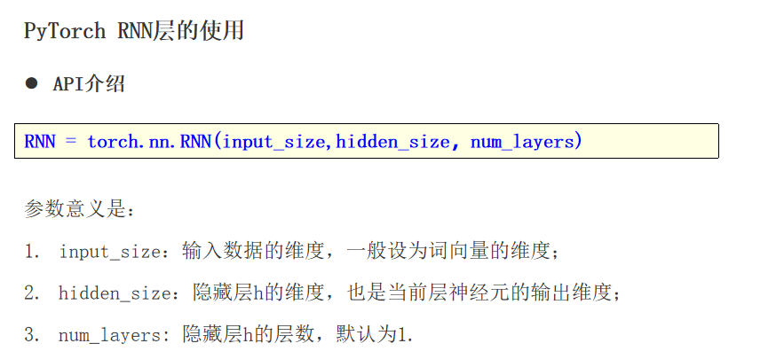

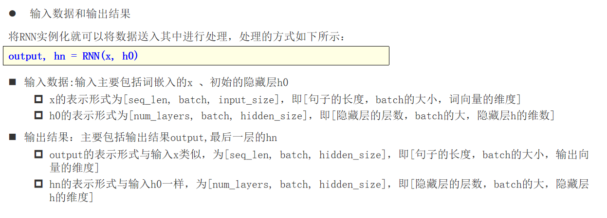


### 内部结构

来源文章：https://colah.github.io/posts/2015-08-Understanding-LSTMs/

- 输入：当前时间步xt和上一时间步输出的ht-1
- 输出：ht和ot （一个时间步内：ht=ot）

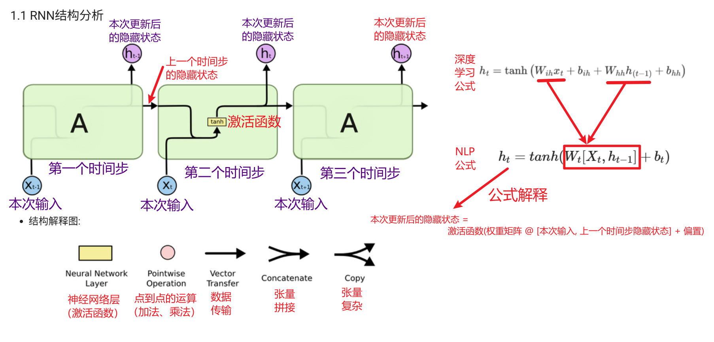


- 多层RNN的解析

  ~~~properties
  output记录的是 最后一层 在每个时间步的隐藏状态。
  hidden 记录的是 每一层 在最后一个时间步的隐藏状态。
  ~~~

  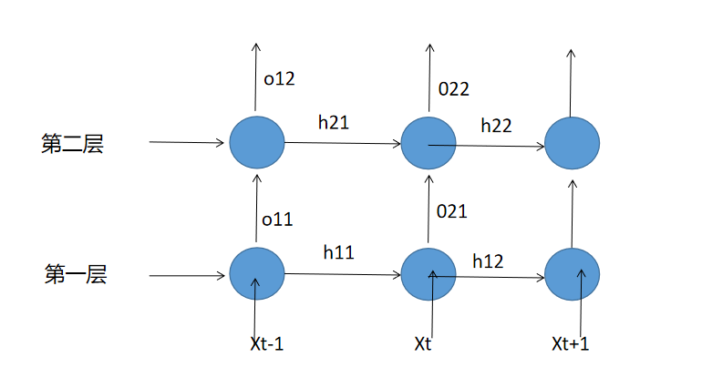

  

### 代码实现

~~~python
import torch
import torch.nn as nn

def rnn_demo(num_layers):
    # 1- 创建RNN循环网络层
    rnn = nn.RNN(input_size=4,hidden_size=5,num_layers=num_layers,batch_first=False)

    # 2- 准备数据
    # 2.1- 上一个时间步的隐藏状态
    h0 = torch.randn(size=(num_layers,2,5))
    input = torch.randn(size=(3,2,4))

    # 3- 调用RNN网络
    """
        输入参数张量形状：
            上一个时间步的隐藏状态h0：[num_layers隐藏层层数,batch_size每个批次中样本的条数,hidden_size隐藏状态向量维度]
            本次输入数据input：[seq_len每条样本中词的个数,batch_size每个批次中样本的条数,input_size词向量维度]
        
        输出参数张量形状：
            更新后的隐藏状态hidden：[num_layers隐藏层层数,batch_size每个批次中样本的条数,hidden_size隐藏状态向量维度]
            本次预测结果output：[seq_len每条样本中词的个数,batch_size每个批次中样本的条数,hidden_size隐藏状态向量维度]
    """
    output,hidden = rnn(input, h0)

    print(f"output的形状-->{output.shape}")    # [3,2,5]
    print(f"hidden的形状-->{hidden.shape}")    # [num_layers,2,5]

    print(f"output的内容-->\n{output}")
    print(f"hidden的内容-->{hidden}")

if __name__ == '__main__':
    # rnn_demo(num_layers=1)
    rnn_demo(num_layers=2)
~~~

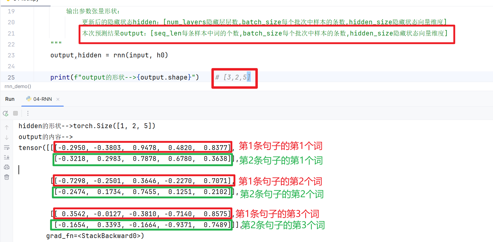


### 总结

传统RNN的优缺点：

~~~properties
优点:
	内部结构简单, 资源消耗相对较小.
缺点:
	处理长序列(一句话中词的个数很多)数据时, 因为 反向传播 结合 梯度连乘, 过大或者过小的w值都会导致 梯度爆炸或者梯度消失.
	
	梯度爆炸：梯度值越来越大，导致权重值越来越大偏离最优的结果
	梯度消失：梯度值越来越小，导致权重值更新非常缓慢甚至不更新
	梯度震荡：学习率设置的不合理，导致权重值在最优点附近来回横跳
~~~


## LSTM模型

### 基本概念

LSTM（Long Short-Term Memory）也称长短时记忆结构, 它是传统RNN的变体, 与经典RNN相比能够有效捕捉长序列之间的语义关联, 缓解梯度消失或爆炸现象，处理长序列数据效果差的问题。同时LSTM的结构更复杂

LSTM由如下四个部分组成:

- 遗忘门
- 输入门
- 细胞状态
- 输出门


> 补充：【门】这个词的理解
>
> 它来自于电子工程，用来控制信号的输出。在NLP中，可以与生活中的门、音量按钮等进行类比理解


### 内部结构【理解】

* 细胞状态：是 LSTM 的记忆库，贯穿整个序列，用来解决长序列记忆问题

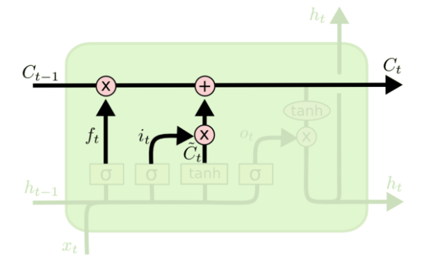


- 遗忘门：决定上一个时间步输出的细胞状态中，哪些内容需要丢弃掉

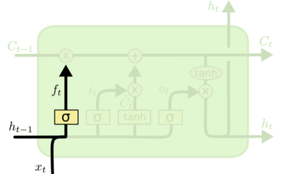

- 输入门：当前输入的数据中，哪些要记录到细胞状态中

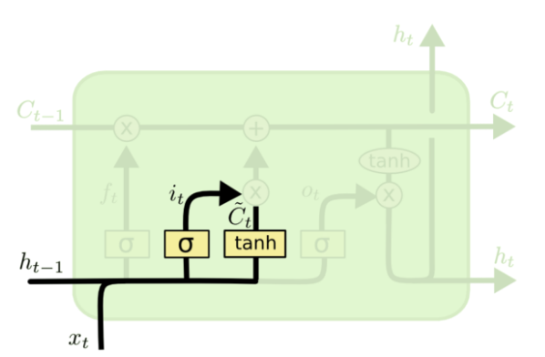


- 输出门：决定本次隐藏状态要输出哪些信息

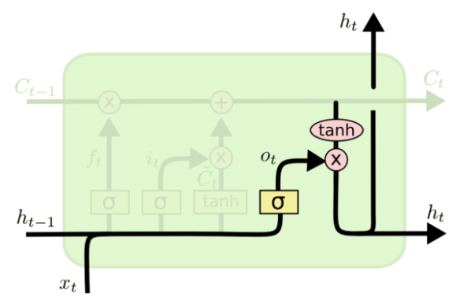


* 完整结构图解释

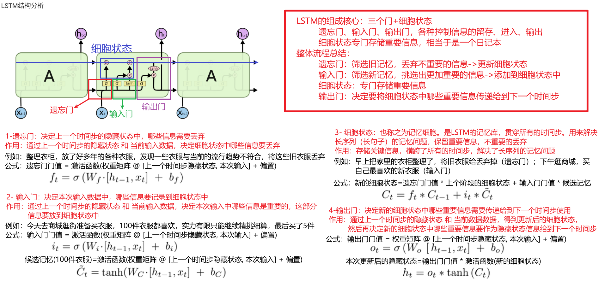


### 代码实现【掌握】

~~~python
import torch
import torch.nn as nn

if __name__ == '__main__':
    # 1- 创建LSTM网络结构
    """
        参数解释：
            bidirectional：是否是双向的网络结构。默认是False，也就是单向的。如果设置为True，LSTM就变成Bi-LSTM
    """
    lstm = nn.LSTM(input_size=4,hidden_size=5,num_layers=1,bidirectional=False)

    # 2- 准备数据
    # input的形状：[seq_len句子中词的个数,batch_size每个批次句子的个数,input_size词向量的维度]
    input = torch.randn(size=(6,3,4))

    """
        因为最终的隐藏状态是根据细胞状态经过激活函数处理得到的，
        但是激活函数不会改变张量的形状，只会改变值
        因此：隐藏状态 和 细胞状态 的张量形状是相同的
        实际工作中，一般对隐藏状态 和 细胞状态全都使用全0初始化
    """
    h0 = torch.zeros(size=(1,3,5))
    c0 = torch.zeros(size=(1,3,5))

    # 3- 调用LSTM
    """
        output形状：[seq_len,batch_size,hidden_size]
        hidden形状：[num_layers,batch_size每个批次句子的个数,hidden_size]
    """
    
    # 注意：传递和接受结果，都需要将隐藏状态 和 细胞状态用元组包起来
    output,(hidden,c1) = lstm(input,(h0,c0))

    print(f"output形状-->{output.shape}") # 6,3,5
    print(f"hidden形状-->{hidden.shape}")
    print(f"c1形状-->{c1.shape}") # 1,3,5

    print(f"output-->{output}")
    print(f"hidden-->{hidden}")
    print(f"c1-->{c1}")
~~~


### Bi-LSTM

定义: 不改变原始的LSTM模型内部结构，只是将文本从左到右计算一遍，再从右到左计算一遍，把最终的输出结果拼接得到模型的完整输出

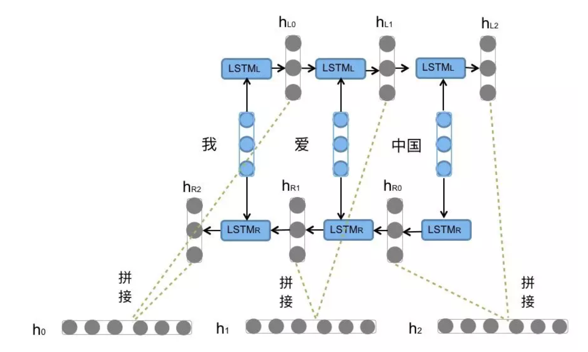


```python
import torch
import torch.nn as nn

if __name__ == '__main__':
    # 1- 创建LSTM
    """
        参数解释：
            bidirectional：LSTM循环网络层是否是双向的。如果为True，那就是Bi-LSTM
                        如果是双向的LSTM，那么隐藏状态 和 细胞状态 张量中第一个形状=num_layers*2
    """
    lstm = nn.LSTM(input_size=4,hidden_size=5,num_layers=2,batch_first=False,bidirectional=True)

    # 2- 准备数据
    # 2.1- 本次输入数据
    input = torch.randn(size=(3,2,4))

    # 2.2- 上一个时间步的隐藏状态。初始隐藏状态一般全0初始化
    h0 = torch.zeros(size=(4,2,5))

    # 2.3- 上一个时间步的细胞状态。初始细胞状态一般全0初始化，它的形状与隐藏状态的形状完全一样
    c0 = torch.zeros(size=(4, 2, 5))

    # 3- 调用LSTM
    """
        注意：隐藏状态  与  细胞状态  顺序，不能调整；并且这两个值要用小括号包起来
        输入参数：本次输入数据, (上一个时间步的隐藏状态, 上一个时间步的细胞状态)
        返回结果：本次预测结果, (更新后的本次时间步隐藏状态, 更新后的细胞状态)
    """
    output,(hidden,c) = lstm(input,(h0,c0))

    print(f"output的形状-->{output.shape}")  # [3,2,5]
    print(f"hidden的形状-->{hidden.shape}")  # [4,2,5]
    print(f"细胞状态的形状-->{c.shape}")  # [4,2,5]

    print(f"output的内容-->\n{output}")
    print(f"hidden的内容-->{hidden}")
    print(f"细胞状态的内容-->{c}")
```

### 总结

LSTM的优缺点是什么？

```properties
优点:
    1. 能够处理更长的句子
    2. 缓解梯度消失或爆炸的问题 -> 训练更稳定.
    3. 能够抓取复杂的特征.
缺点:
    1. 计算慢, 消耗资源大.
    2. 调参相对较难.
    3. 可解释性稍差.
```


## GRU模型

### 基本概念

GRU（Gated Recurrent Unit）也称门控循环单元结构, 它也是传统RNN的变体, 同LSTM一样能够有效捕捉长序列之间的语义关联, 缓解梯度消失或爆炸现象. 同时它的结构和计算要比LSTM更简单, 它的核心结构可以分为两个部分去解析:

- 更新门
- 重置门


### 内部结构【理解】

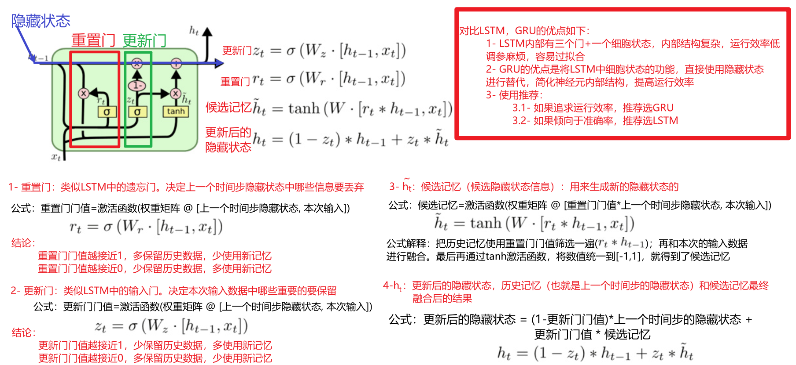


### 代码实现【掌握】

~~~python
import torch
import torch.nn as nn

def gru_demo(num_layers):
    # 1- 创建GRU循环网络层
    """
        参数解释：
            bidirectional：GRU循环网络层是否是双向的。如果为True，那就是Bi-GRU
                        如果是双向的GRU，那么隐藏状态 和 细胞状态 张量中第一个形状=num_layers*2
    """
    gru = nn.GRU(input_size=4,hidden_size=5,num_layers=num_layers,batch_first=False,bidirectional=False)

    # 2- 准备数据
    # 2.1- 上一个时间步的隐藏状态
    h0 = torch.randn(size=(num_layers,2,5))
    input = torch.randn(size=(3,2,4))

    # 3- 调用GRU网络
    """
        输入参数张量形状：
            上一个时间步的隐藏状态h0：[num_layers隐藏层层数,batch_size每个批次中样本的条数,hidden_size隐藏状态向量维度]
            本次输入数据input：[seq_len每条样本中词的个数,batch_size每个批次中样本的条数,input_size词向量维度]
        
        输出参数张量形状：
            更新后的隐藏状态hidden：[num_layers隐藏层层数,batch_size每个批次中样本的条数,hidden_size隐藏状态向量维度]
            本次预测结果output：[seq_len每条样本中词的个数,batch_size每个批次中样本的条数,hidden_size隐藏状态向量维度]
    """
    output,hidden = gru(input, h0)

    print(f"output的形状-->{output.shape}")    # [3,2,5]
    print(f"hidden的形状-->{hidden.shape}")    # [num_layers,2,5]

    print(f"output的内容-->\n{output}")
    print(f"hidden的内容-->{hidden}")

if __name__ == '__main__':
    # gru_demo(num_layers=1)
    gru_demo(num_layers=2)
~~~


### Bi-GRU

定义: 不改变原始的GRU模型内部结构，只是将文本从左到右计算一遍，再从右到左计算一遍，把最终的输出结果拼接得到模型的完整输出


### 总结

GRU的优缺点是什么？

~~~properties
优点：相比LSTM，结构较为简单，能够和lstm一样缓解梯度消失问题
缺点：只能缓解了梯度消失和爆炸问题, 不能并行计算
~~~


~~~properties
RNN、LSTM、GRU使用总结:
	1- 如果项目、需求简单，短序列（<50）的时候使用RNN
	2- 如果是中等序列（50-200）的使用使用GRU
	3- 如果是长序列（>200）的时候使用LSTM
	4- 如果是计算资源充足，推荐使用LSTM、Bi-LSTM、Bi-GRU；如果资源紧张考虑GRU
~~~


## 注意力机制【理解】

### 基本概念

Seq2Seq是啥，它和RNN、LSTM、GRU的关系和区别是啥？

~~~properties
1- Seq2Seq是一种模型架构，用于将一个序列映射到另一个序列。典型结构是 Encoder-Decoder（编码器-解码器）
2- RNN、LSTM、GRU是神经元内部结构
3- Seq2Seq模型的编码器和解码器通常由 RNN、LSTM 或 GRU 构成
4- 可以将Seq2Seq理解为房子，RNN、LSTM、GRU理解为建房子的砖
~~~


什么是机器翻译？

~~~properties
A文字 -> B文字，语言一样，叫文本生成
A文字 -> B文字，语言不同，叫机器翻译
~~~


注意力机制是什么意思？

~~~properties
将人类对事物的观察的习惯、能力，迁移到神经网络中，让模型在进行机器翻译、文本生成的时候，重点关注原始数据中的什么内容。

注意力机制（Attention Mechanism）是深度学习中一种增强模型对输入数据中重要信息关注能力的技术
注意力机制让模型在处理序列数据时动态地赋予不同输入数据不同的权重
~~~


### 注意力机制的由来

```properties
没有注意力机制之前存在的弊端: 
	弊端1: 如果翻译的句子很长很复杂，比如直接一篇文章输进去，模型的计算量很大，并且模型的准确率下降严重
	弊端2: 没有考虑词与词之间的相关性，导致翻译效果比较差
```

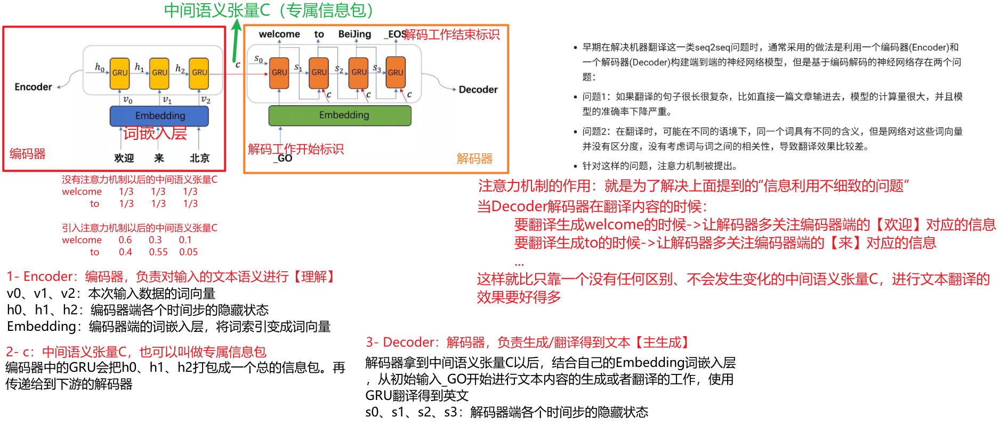


### 什么是注意力机制

==注意力机制是将人的感知方式、注意力的行为应用在机器上，让机器学会去感知数据中的重要和不重要的部分。==

将人类对事物的观察的习惯、能力，迁移到神经网络中，让模型在进行机器翻译、文本生成的时候，重点关注原始数据中的什么内容。


### 注意力机制分类及其实现

#### 基本概念

```properties
1、【重点】软注意力: 也称之为全局注意。注意力权重值分布在0-1之间，关注所有的词汇，但是不同词汇根据权重大小关注的程度不一样。
2、硬注意力: 也称之为局部注意。注意力权重值是0或者1，只关注哪些重要的部分，忽略次要的部分
3、自注意力: 也称之为内注意。通过输入项内部的"表决"来决定应该关注哪些输入项.
```


#### 软注意力

##### 没有加Attention的Encoder-Decoder框架

==这个图主要理解谁是Target，谁是Source==

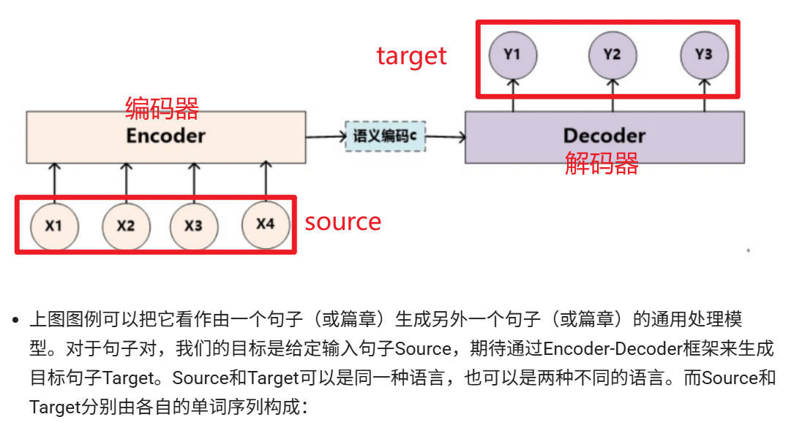


##### 加Attention的Encoder-Decoder框架

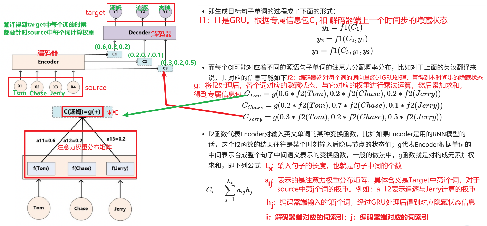

==专属信息包C如何来的：权重值和对应的隐藏状态进行乘法，然后累加求和==


##### 如何得到注意力概率分布

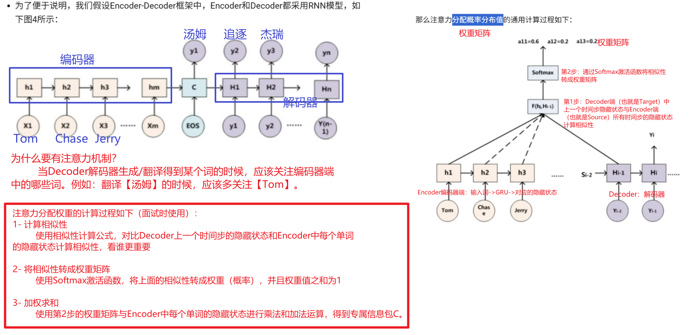


~~~properties
为什么要计算注意力分配系数？
	在Decoder生成当前词时，该重点关注Encoder里哪些单词
	例如：生成 汤姆 时，该多关注Encoder中的Tom、还是Chase、还是Jerry


注意力分配权重的计算过程如下(面试时使用)
1-计算相似性
使用相似性计算公式，对比Decoder上一个时间步的隐藏状态和Encoder中每个单词的隐藏状态计算相似性，看谁更重要
2-将相似性转成权重矩阵
使用Softmax激活函数，将上面的相似性转成权重(概率)，并且权重值之和为1
3-加权求和
使用第2步的权重矩阵与Encoder中每个单词的隐藏状态进行乘法和加法运算，得到专属信息包C
~~~


##### Attention机制的本质思想

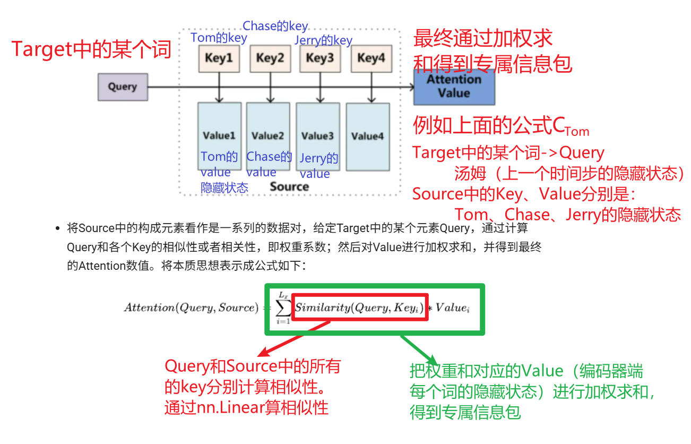

~~~properties
几个英文单词的关系：
	Encoder编码器：
		Source：
			Key
			Value
	
	Decoder解码器：
		Target：
			Query

以使用百度为例：
	搜索内容: 人工智能		-> Query
	匹配过程: 网页源代码	   -> Key
	查看结果: 网页详情页面  -> Value

Seq2Seq+注意力机制的架构中：
	Query: 是解码器中上一个时间步中GRU隐藏层输出的隐藏状态
	Key: 是编码器中当前时间步中GRU隐藏层输出的隐藏状态的拼接
	Value: 与Key是完全相同的，是编码器中当前时间步中GRU隐藏层输出的隐藏状态的拼接
~~~


==计算的详细过程【掌握】==：

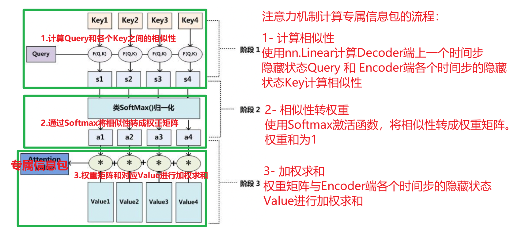

~~~properties
总结(面试使用):注意力分配权重的计算过程
1- 计算相似性
使用nn.Linear计算Decoder端上一个时间步隐藏状态Query 和 Encoder端各个时间步的隐藏状态Key计算相似性

2- 相似性转权重
使用Softmax激活函数，将相似性转成权重矩阵。权重和为1

3- 加权求和
权重矩阵与Encoder端各个时间步的隐藏状态Value加权求和

Key和Value大多数情况是完全相同，表示编码器端的词经过GRU以后得到的隐藏状态
~~~


#### 硬注意力【了解】

~~~properties
硬性注意力: 根据注意力分布选择输入向量中的一个作为输出。这里有两种选择方式：
	1- 选择注意力分布中，分数最大的那一项对应的输入向量作为Attention机制的输出
	2- 根据注意力分布进行随机采样，采样结果作为Attention机制的输出
	只关注被选中的部分，那么权重就是1；没选中的不关注，那么权重就是0
	
硬性注意力通过以上两种方式选择Attention的输出，这会使得最终的损失函数与注意力分布之间的函数关系不可导，导致无法使用反向传播算法训练模型，硬性注意力通常需要使用强化学习来进行训练。因此，一般深度学习算法会使用软性注意力的方式进行计算。
~~~


#### 自注意力

~~~properties
自注意力机制: 对每个输入项分配的权重取决于输入项之间的相互作用，即通过输入项内部的"表决"来决定应该关注哪些输入项。
也就是指的是Source内部元素之间或者Target内部元素之间发生的注意力机制，也可以理解为Target=Source这种特殊情况下的注意力机制。

和前两种相比，在处理很长的输入时，具有并行计算的优势。

Transformer框架内部用到了自注意力机制。

结论: query、key、value，如果相等，就是自注意力机制；否则就不是
~~~


### 注意力计算规则

#### Pytorch中注意力机制计算原理

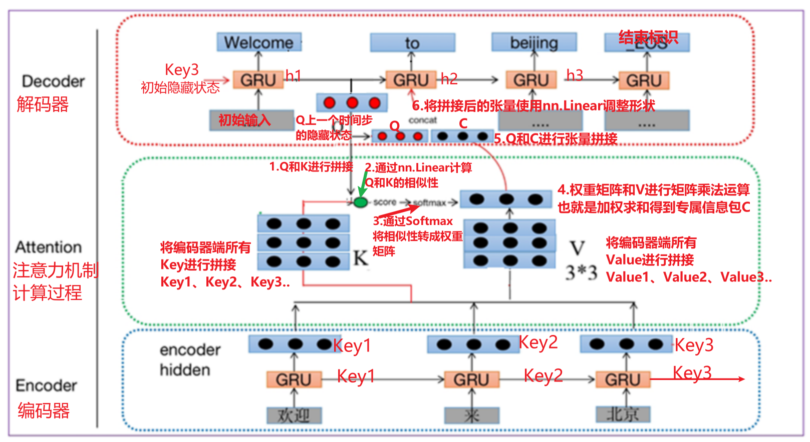

~~~properties
以翻译得到单词to为例介绍完整的流程

Encoder编码器端：
	1: 欢迎、来、北京 经过词嵌入层的处理得到对应的词向量
	2: 再将词向量送入到GRU中，得到对应的隐藏状态。对应时间步的隐藏状态再经过线性变换得到Key和Value。具体请看下面的【问题二：K或者V的具体来源】
	3: 对编码器端所有词对应的Key、Value进行张量拼接，分别得到K、V
		例如：每个批次batch_size中有2条句子，seq_len每条句子中词的个数有5个，每个词的隐藏状态向量维度8
		那么K和V的张量形状是[2batch_size, 5seq_len, 8hidden_size]
	4: 最后一个时间步的隐藏状态Key3作为初始隐藏状态给到Decoder解码器使用
	

Decoder解码器端：
	1: 解码器初始输入GO作为翻译的起始标识，输入到GRU中，翻译得到第一个词Welcome和本次更新后的隐藏状态h1
	2: 将上一个时间步的隐藏状态h1作为Q
	3: Q和K进行张量concat拼接
	4: 通过nn.Linear计算Q和K的相似性得分
	5: 通过Softmax激活函数将相似性得分转成权重矩阵
	6: 权重矩阵和V进矩阵乘法运算，也就是加权求和得到专属信息包C，专属于to的信息包
	7: Q和专属信息包C进行张量concat拼接
	8: 通过nn.Linear对拼接后的张量形状进行调整，以满足GRU的输入要求
~~~


问题一：上面讲的是翻译to之前计算专属信息包，那翻译Welcome的时候，专属信息包如何计算的？也就是【编码器端最后一个时间步的隐藏状态Key3会作为解码器端的初始隐藏状态h0使用，会作为Q】，而Q第一步又会和K拼接以及算相似性，那么不会出现重点关注【北京】词，而不是【欢迎】词吗？

答：

​	1- 编码器端最后一个时间步的隐藏状态Key3会作为解码器端的初始隐藏状态h0使用：**并不是直接使用**，中间会经过nn.Linear的线性变换，变换后Q和K的相似性就低了

​	2- 前向传播看起来类似，但是不要忘记还有反向传播，通过让损失值减小，会让注意力重点关注【北京】词。在训练过程中，如果模型错误地关注了“北京”，导致翻译错误，损失函数会很大。反向传播会调整权重 W ，使得与“北京”相关的分数降低，与“欢迎”相关的分数升高。


问题二：K或者V的具体来源

答：原始输入词 -> 词嵌入层 -> 词向量 -> GRU循环神经元 -> ==当前时间步隐藏状态h -> 线性变化Wh -> 每个时间步的Key== -> 拼接 -> K和V。==K和V的张量形状[batch_size, seq_len, hidden_size]==

在编码器端，RNN按时间步处理输入序列，每个时间步的隐藏状态计算为：

$ h_t=tanh⁡(W^{xh}⋅x_t+W_{hh}⋅h_{t−1}+b_h) $

**Key是由所有时间步的隐藏状态组成的矩阵**，经过线性变换得到：

$ K=[h1,h2,...,hn]⋅W^K $


> 以上理论对应的大模型prompt如下：https://www.qianwen.com/share/chat/6502a8a327cc4bc8a457210bf71b5594
>
> 第一个：Seq2Seq+注意力机制中，Query、Key、Value的详细来源，以及专属信息包C的完整计算过程
>
> 第二个：K具体是如何来的，是直接来自于隐藏状态吗


#### 计算公式

计算规则前提

```properties
1- 当Q、K、V相等, 称作自注意力
2- 当Q、K、V不相等时，称为一般注意力（包括软注意力、硬注意力）
3- 自注意力 和 一般注意力的区别，只是数据层面（也就是QKV是否相等）的区别
4- 具体计算得到 自注意力 和 一般注意力，有如下的3种公式。目前使用最多的是第1个和第3个。

注意: 
	1: 不要将注意力的三种类别（软注意力、硬注意力、自注意力） 和 注意力计算的3个公式搞混
	2: 也就是下面的3个公式，即能够算软注意力，也能够算自注意力
	3: Transformer框架中使用的是第3个公式算自注意力，原因是除以根号dk
```


三种规则方法

* 公式1: 将Q和K进行纵轴拼接，然后经过线性变换，再经过Softmax进行处理得到权重，最后和V进行相乘

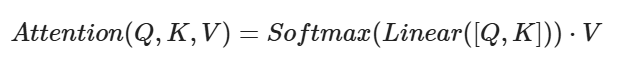


* 【了解】公式2：将Q和K进行纵轴拼接，接着经过一次线性变化，然后进过tanh激活函数处理，再进行sum求和，再经过softmax进行处理得到权重，最后和V进行张量的乘法

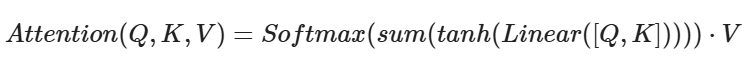


* 公式3：将Q和K的转置进行点乘，然后除以一个缩放系数，再经过softmax进行处理得到权重，最后和V进行张量的乘法

==注意：dk是k的维度，等于词向量的维度 或者 隐藏状态维度==

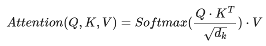

> **常见面试题：为什么公式要除以根号dk**
>
> **答：防止矩阵点乘运算结果过大，导致Softmax计算后概率值出现极端值，极大或极小。避免模型对这些极值学习的不好**

> **【了解】K为什么要转置？**
>
> **举例：**
>
> ​	**K和V的形状是相同的，假设K的形状是[N个词, M的隐藏状态]**
>
> ​	**Q是单个时间步的隐藏状态，形状是[1, M的隐藏状态]**
>
> ​	**为了能和V进行矩阵乘法运算，那么K需要转置**


bmm函数介绍：

~~~python
import torch

"""
    bmm和matmul对比总结
        1- 都能够实现矩阵乘法运算。matmul是串行计算，效率低；bmm是并行计算，效率高
        2- 如果matmul的张量形状不等，会进行广播机制
        3- bmm的要求如下：
            3.1- 参与运算的两个张量的形状有且只能是三维。形状的含义(batch_size,行数,列数)
            3.2- 参与运算的两个张量的batch_size必须相等
            3.3- 参与运算的两个张量中，前一个张量的列数 与 后一个张量的行数 必须相同
            
    后面在计算注意力的时候，如果满足bmm的要求，推荐使用bmm；当然可以无脑使用matmul，因为兼容性更好
"""
if __name__ == '__main__':
    # 准备数据
    mat_1 = torch.randint(low=1,high=5,size=(10,3,4))
    # mat_1 = torch.randint(low=1,high=5,size=(1,3,4))
    mat_2 = torch.randint(low=1,high=5,size=(10,4,5))

    # matmul
    matmul_result = mat_1 @ mat_2
    print("matmul_result：",matmul_result.shape)

    # bmm
    bmm_result = torch.bmm(mat_1,mat_2)
    print("bmm_result：", bmm_result.shape)
~~~


### 注意力机制的作用

~~~properties
注意：编码器、解码器都可以选择是否要加注意力机制
1- 编码器、解码器【都不加】注意力机制，那么就是最初的Seq2Seq
2- 编码器、解码器【都加】注意力机制，那么就是后面要学的Transformer架构
3- 编码器不加注意力机制，而解码器加注意力机制，那么就是Seq2Seq+注意力
4- 编码器加注意力机制，而解码器不加注意力机制，这种情况很少见
~~~

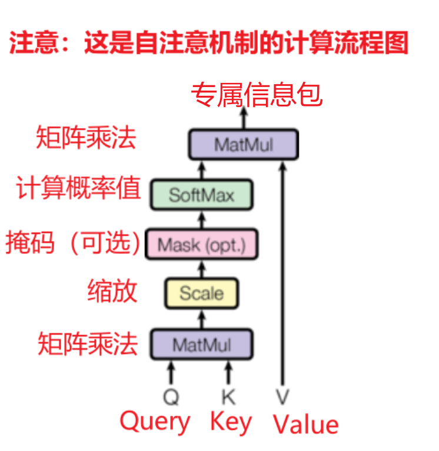


### 实现注意力机制【掌握】

* 步骤

```properties
第一步: 按照注意力规则，对Q、K、V进行注意力的计算
第二步: 如果第一步是拼接操作，需要将Q和第一步计算的结果进行再次拼接，如果是点乘运算，Q和K、V相等，不需要拼接
第三步: 我们需要将第二步的结果，进行线性变化，按照指定输出维度进行结果的表示
```


* 原理图

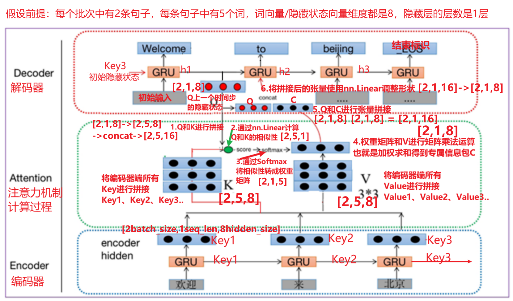


* 代码实现

```properties
import torch
import torch.nn as nn
from torch import Tensor


class MyAtten(nn.Module):
    def __init__(self,query_size,key_size,c_size,output_size):
        """
        :param query_size: 张量Q最后一个维度的形状，目前这里就是8
        :param key_size: 张量K最后一个维度的形状，目前这里就是8
        :param c_size: 张量C最后一个维度的形状，目前这里就是8
        :param output_size: Q和C拼接后，并且经过线性调整形状后的张量中最后一个维度的形状，目前这里就是8
        """

        # 1- 初始化父类
        super().__init__()

        # 2- 设置属性值
        self.query_size = query_size
        self.key_size = key_size
        self.c_size = c_size
        self.output_size = output_size

        # 3- 搭建网络结构
        # 3.1- 计算QK相似性的线性层。对应原理图中的第2步
        self.score_linear = nn.Linear(in_features=self.query_size+self.key_size,out_features=1)
        # self.score_linear = nn.Linear(in_features=16,out_features=1)

        # 3.2- 调整Q和C拼接后的张量形状线性层。对应原理图中的第6步
        self.qc_linear = nn.Linear(in_features=self.query_size+self.c_size,out_features=self.output_size)
        # self.qc_linear = nn.Linear(in_features=16,out_features=8)

    def forward(self,Q:Tensor,K,V):
        """
        目前暂时不研究QKV如何来的。只计算数据准备好后的注意力的计算过程。对应原理图中中间的绿色框
        :param Q: query，张量形状[batch_size,num_layers,hidden_size] -> [2,1,8]
        :param K: key，张量形状[batch_size,seq_len,hidden_size] -> [2,5,8]
        :param V: value，与key完全一致，张量形状[batch_size,seq_len,hidden_size] -> [2,5,8]
        :return:
        """
        # 1- Q和K拼接
        # 1.1- Q和K目前不能直接拼接，需要将Q的形状 由 [2,1,8] -> [2,5,8]
        seq_len = K.shape[1]
        # expand：扩大张量的形状。-1表示调整前后对应位置的形状不变
        Q_expand = Q.expand(size=(-1,seq_len,-1))
        print(f"1-->{Q.shape}") # [2,1,8]
        print(f"2-->{Q_expand.shape}") # [2,5,8]

        # 1.2- 拼接：Q_expand [2,5,8] K [2,5,8] -> [2,5,16]
        qc_cat = torch.cat(tensors=(Q_expand,K), dim=-1)
        print(f"3-->{qc_cat.shape}") # [2,5,16]

        # 2- 使用线性层对QK拼接后的结果计算相似性
        score = self.score_linear(qc_cat)
        print(f"4-->{score.shape}") # [2,5,1]

        # 3- 将相似性转成权重矩阵
        # 3.1- 调整score的形状：由[2,5,1] -> [2,1,5]
        score = score.transpose(dim0=1,dim1=2)
        print(f"5-->{score.shape}") # [2,1,5]

        # 3.2- 调用Softmax
        weighted_mat = torch.softmax(score, dim=-1)
        print(f"6-->{weighted_mat.shape}") # [2,1,5]

        # 4- 加权求和：权重矩阵和V进行矩阵乘法。计算得到专属信息包
        # weighted_mat [2,1,5]；V [2,5,8] -> [2,1,8]
        C = torch.bmm(weighted_mat, V)
        print(f"7-->{C.shape}") # [2,1,8]

        # 5- Q和C拼接：Q [2,1,8]；C [2,1,8] -> [2,1,16]
        qc_cat = torch.cat(tensors=(Q,C), dim=-1)
        print(f"8-->{qc_cat.shape}") # [2,1,16]

        # 6- 对拼接后的张量进行形状调整，以满足Decoder端GRU输入数据的要求
        result = self.qc_linear(qc_cat)
        print(f"9-->{result.shape}") # [2,1,8]

        return result,weighted_mat

if __name__ == '__main__':
    # 因为只讲PyTorch中注意力是如何计算得到。因此拼接后的value、Q、V我们直接手动初始化

    # 1- 定义基础变量
    batch_size = 2      # 每个批次中句子的条数
    seq_len = 5         # 每个句子中词的个数
    hidden_size = 8     # 我们人为设置词向量维度和隐藏向量维度相同
    num_layers = 1      # 隐藏层层数为1

    # 2- 初始化Q、K、V
    """
        为什么Q的形状中间是1？
        答：当前只针对Decoder解码器端一个时间步。当前时刻拿一个Q，去和Encoder全部位置算相似性
    """
    Q = torch.randn(size=(batch_size,num_layers,hidden_size))   # Decoder端当前时间步的隐藏状态
    K = torch.randn(size=(batch_size,seq_len,hidden_size))      # Encoder端多个词的隐藏状态拼接后的
    V = torch.randn(size=(batch_size,seq_len,hidden_size))      # Encoder端多个词的隐藏状态拼接后的

    # 3- 计算注意力
    query_size = hidden_size
    key_size = hidden_size
    c_size = hidden_size
    output_size = hidden_size

    attn_model = MyAtten(query_size,key_size,c_size,output_size)
    output,attn_weight = attn_model(Q,K,V)

    print(f"权重值{attn_weight}")
    print(f"权重值和{attn_weight.sum()}")
```


运行结果：

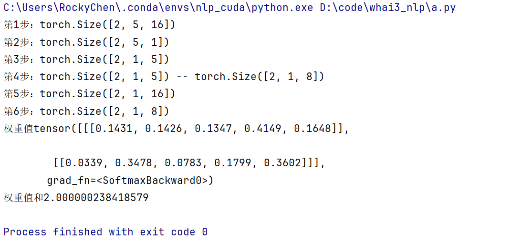


## 让代码运行在GPU上

==Windows、Linux、Mac(M芯片)均可==

==Windows(无独显)、Mac(Intel芯片)不行==

* 步骤

~~~properties
1: 【推荐】创建新的虚拟环境进行操作
	conda create -n nlp_cuda python==3.10
	
2: 进入虚拟环境
	conda activate nlp_cuda

3: 去黑窗口查看你本机的CUDA版本。【推荐】先升级英伟达。【操作截图见下面】
	nvidia-smi

4: 去Pytorch官网找到对应你cuda版本的下载命令，【截图见下面】
	官网地址: https://pytorch.org

5: 安装对应版本的cuda。安装命令
	pip3 install torch torchvision --index-url https://download.pytorch.org/whl/cu130

6: 在PyCharm中关联新的沙箱, 运行下边的代码测试即可.

7: 如果不OK,大概率是 显卡驱动(Cuda版本) 和 你的PyTorch版本不兼容, 建议: 直接更新驱动.

8: 要安装的其他包，一个一个安装即可
	pip install jieba -i https://pypi.tuna.tsinghua.edu.cn/simple/
    pip install tensorflow -i https://pypi.tuna.tsinghua.edu.cn/simple/
    pip install joblib -i https://pypi.tuna.tsinghua.edu.cn/simple/
    pip install fasttext-wheel -i https://pypi.tuna.tsinghua.edu.cn/simple/
    pip install seaborn -i https://pypi.tuna.tsinghua.edu.cn/simple/
    pip install matplotlib==3.8.4 -i https://pypi.tuna.tsinghua.edu.cn/simple/
    pip install tqdm -i https://pypi.tuna.tsinghua.edu.cn/simple/
~~~

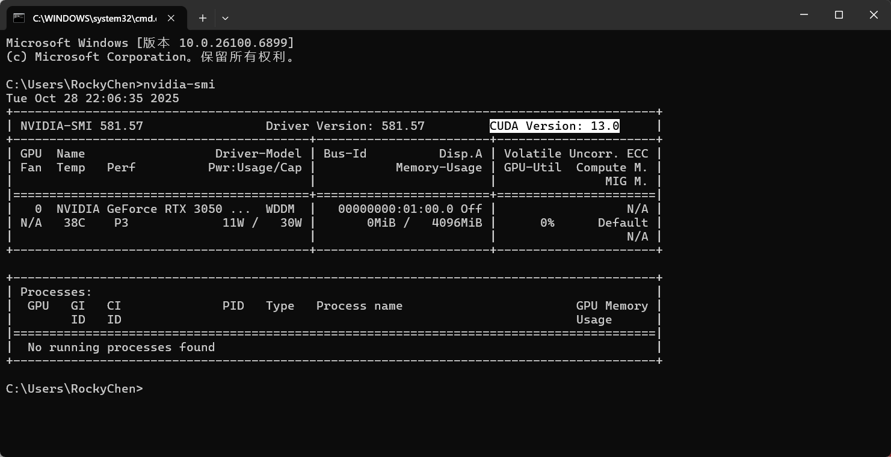


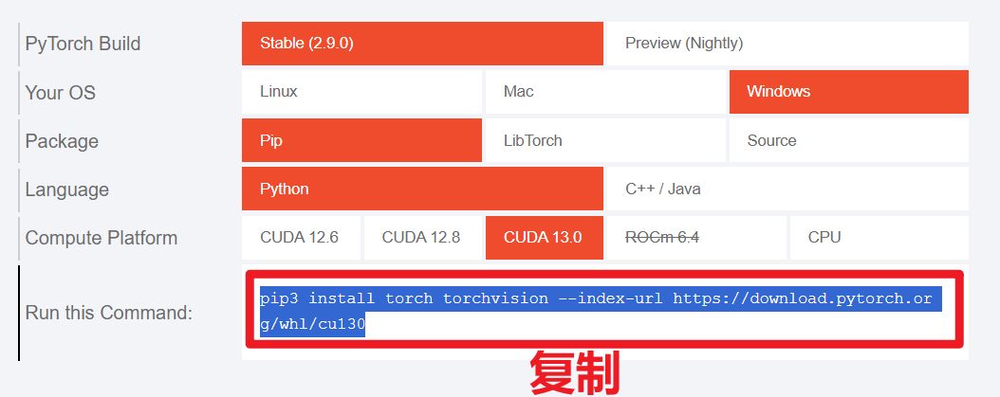

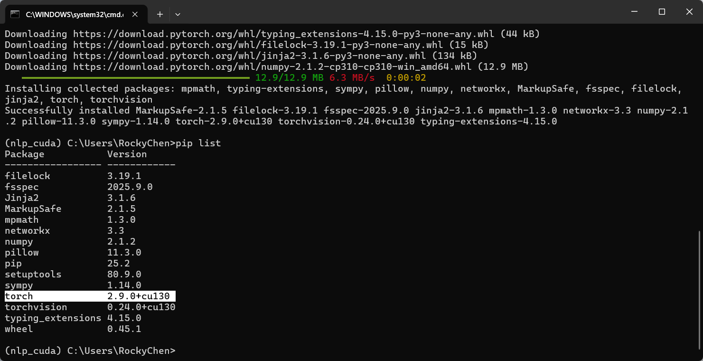

* 代码

~~~python
import torch

# 设备选择，我们可以选择在cuda或者cpu上运行你的代码
device = torch.device("cuda" if torch.cuda.is_available() else "cpu")
# 如果是Mac M芯片, 写这个
# device = 'mps'

print(f'device: {device}')
~~~


## Seq2Seq英译法案例【多练习】

### 任务目的

```properties
目的: 给定一段英文，翻译为法文
典型的文本分类任务: 每个时间步去预测应该属于哪个法文单词
```


### 数据格式

- 注意：两列数据，第一列是英文文本，第二列是法文文本，中间用制表符号"\t"隔开

```properties
i am from brazil .  je viens du bresil .
i am from france .  je viens de france .
i am from russia .  je viens de russie .
i am frying fish .  je fais frire du poisson .
i am not kidding .  je ne blague pas .
```


### 实现流程

```properties
1. 获取数据:案例中是直接给定的
2. 数据预处理: 脏数据清洗、数据格式转换、数据源Dataset的构造、数据迭代器Dataloader的构造
3. 模型搭建: 编码器和解码器等一系列模型
4. 模型评估
5. 模型上线
```


### 基础准备

~~~python
import random
import re
import torch
import torch.nn as nn
from torch.utils.data import Dataset,DataLoader
from tqdm import tqdm
import matplotlib.pyplot as plt

# 1- 设置变量
# 运行设备
device = ("cuda" if torch.cuda.is_available() else "cpu")   # Windows的写法
# device = "mps"  # Mac的写法

# 数据文件路径
data_path = "data/eng-fra-v2.txt"

# 句子开始标识
SOS_TOKEN = 0

# 句子结束标识
EOS_TOKEN = 1

# 句子长度规范：长度的上限
MAX_LENGTH = 10
~~~


### 数据预处理

#### 定义样本清洗函数和构建字典

- 目的

```properties
样本清洗函数: 将脏数据进行清洗，以免影响模型训练
构建字典:一方面是为了将文本进行数字表示，还有一方面进行解码的时候将预测索引数字映射为真实的文本
```

- 样本清洗函数代码实现

```python
# 2- 数据清洗
def normalizeString(line):
    # 将文本全部转小写
    line = line.lower().strip()
    # print(f"-{line}-")

    # 在指定的标点符号的前面增加空格
    line = re.sub(pattern=r"([.!?])",repl=r" \1",string=line)

    # 去除除了26个小写、.!?以外的其他符号，全部替换成空格
    line = re.sub(pattern=r"[^a-z.!?]+", repl=r" ", string=line)

    return line
```

- 构建字典代码实现

```python
# 3- 构建词汇表
def getdata():
    # 1- 读取文件
    with open(data_path,encoding="UTF-8",mode="r") as f:
        eng_fra_list = f.readlines()

    # 2- 划分得到英语和法语
    # eng_fra_pairs结构：[[英语句子1, 法语句子1], [英语句子2, 法语句子2]...]
    eng_fra_pairs = []
    for eng_fra_line in eng_fra_list:

        tmp_list = []
        for line in eng_fra_line.split("\t"):
            tmp_list.append(normalizeString(line))

        eng_fra_pairs.append(tmp_list)

    # 3- 分别得到英语词汇表和法语词汇表
    english_word2index = {"SOS":SOS_TOKEN,"EOS":EOS_TOKEN}
    english_word_cnt = 2

    franch_word2index = {"SOS":SOS_TOKEN,"EOS":EOS_TOKEN}
    franch_word_cnt = 2

    for eng_fra_list in eng_fra_pairs:
        # 英语句子处理：分词->去重->添加
        for eng_word in eng_fra_list[0].split(" "):
            if eng_word not in english_word2index:
                english_word2index[eng_word] = english_word_cnt
                english_word_cnt += 1

        # 法语句子处理：分词->去重->添加
        for fra_word in eng_fra_list[1].split(" "):
            if fra_word not in franch_word2index:
                franch_word2index[fra_word] = franch_word_cnt
                franch_word_cnt += 1

    # 4- 将法语字典中key和value的位置交换
    franch_index2word = {index:word for word,index in franch_word2index.items()}

    return english_word2index,english_word_cnt,franch_word2index,franch_word_cnt,eng_fra_pairs,franch_index2word

english_word2index,english_word_cnt,franch_word2index,franch_word_cnt,eng_fra_pairs,franch_index2word = getdata()
```


#### 构建DataSet

- 目的

```properties
使用Pytorch框架，一般遵从一个规矩：使用DataSet方法构造数据源，来让模型进行使用
构造数据源的过程中:必须继承torch.utils.data.Dataset类，必须构造两个魔法方法：__len__(), __getitem__()
__len__(): 一般返回的是样本的总个数，我们可以直接len(dataset对象)直接就可以获得结果
__getitem__(): 可以根据某个索引取出样本值，我们可以直接用dataset对象[index]来直接获得结果
```

- 代码实现

```python
# 4- 自定义Dataset
class MyPairsDataset(Dataset):
    def __init__(self,eng_fra_pairs):
        self.eng_fra_pairs = eng_fra_pairs
        self.sample_cnt = len(eng_fra_pairs)    # 样本条数

    def __len__(self):
        return self.sample_cnt

    def __getitem__(self, index):
        # 1- 防止索引为负数；防止索引越界
        index = min(max(index,0), self.sample_cnt - 1)

        # 2- 获得英语句子（特征数据）和法语句子（目标值）
        # 2.1- 获得句子。[英语句子1, 法语句子1]
        eng_fra_pair = self.eng_fra_pairs[index]

        # 句子 -> 分词 -> 变成索引
        """
            为什么只在句子的末尾增加结束标识EOS_TOKEN，而不增加SOS_TOKEN？
            答：
                1- Seq2Seq架构要求必须要有EOS_TOKEN，而SOS_TOKEN可选的
                2- SOS_TOKEN会在Decoder中进行数据处理的时候再增加
                3- Decoder端我们只能通过添加SOS_TOKEN告诉解码器开始进行翻译的工作；以及通过添加EOS_TOKEN告诉解码器翻译工作结束
        """
        # 2.2- 处理英语句子
        x = [english_word2index[word] for word in eng_fra_pair[0].split(" ")]
        # 所有的张量数据必须放在同一个硬件设备上，要么同时在GPU，要么同时在CPU
        x_tensor = torch.tensor(x,dtype=torch.long,device=device)
        # print(f"原始英语句子{eng_fra_pair[0]}，词索引向量{x_tensor}")

        # 2.3- 处理法语句子
        y = [franch_word2index[word] for word in eng_fra_pair[1].split(" ")]
        y.append(EOS_TOKEN)
        y_tensor = torch.tensor(y, dtype=torch.long, device=device)
        # print(f"原始法语句子{eng_fra_pair[1]}，词索引向量{y_tensor}")

        return x_tensor,y_tensor
```


#### 构建Dataloader

- 目的

```properties
为了将Dataset我们上一步构建的数据源，进行再次封装，变成一个迭代器，可以进行for循环，而且，可以自动为我们dataset里面的数据进行增维（bath_size）,也可以随机打乱我们的取值顺序
```

- 代码实现

```python
# 5- 创建DataLoader
def get_dataloader():
    # 1- 创建自定义Dataset实例对象
    dataset = MyPairsDataset(eng_fra_pairs)

    # 2- 创建数据加载器
    dataloader = DataLoader(dataset=dataset,batch_size=1,shuffle=True)

    return dataloader
```


### 模型搭建

#### 搭建编码器GRU模型

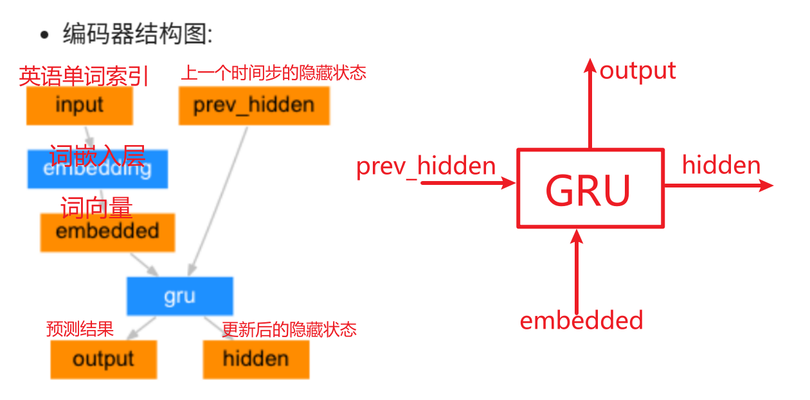

- 代码实现

```python
# 6- 无注意力机制的编码器
class Encoder(nn.Module):
    def __init__(self,eng_vocab_size,input_size,hidden_size):
        """
        :param eng_vocab_size: 英语词汇表大小
        :param input_size: 词向量维度
        :param hidden_size: 隐藏状态向量维度
        """

        # 1- 初始化父类
        super().__init__()

        # 2- 设置属性值
        self.eng_vocab_size = eng_vocab_size
        self.input_size = input_size
        self.hidden_size = hidden_size

        # 3- 搭建网络结构
        # 3.1- 词嵌入层
        self.ebd = nn.Embedding(num_embeddings=self.eng_vocab_size,embedding_dim=self.input_size)

        # 3.2- 循环网络层
        self.gru = nn.GRU(input_size=self.input_size,hidden_size=self.hidden_size,num_layers=1,batch_first=True)

    def forward(self,input,hidden):
        """
        Encoder端的前向传播：负责理解英语句子的语义信息
        :param input: 本次输入数据，张量形状：[batch_size每个批次中英语句子的条数,seq_len英语句子中词的个数]
        :param hidden: 上一个时间步的隐藏状态，张量形状：[num_layers,batch_size,hidden_size]
        :return:
        """
        # 1- 调用词嵌入层
        # embed形状：[batch_size每个批次中英语句子的条数,seq_len英语句子中词的个数,input_size词向量维度]
        # print(f"1--input-->{input.shape}")
        embed = self.ebd(input)
        # print(f"2--embed-->{embed.shape}")

        # 2- 调用GRU
        output,hidden = self.gru(embed,hidden)

        return output,hidden

    def init_hidden(self):
        # 隐藏状态张量形状：[num_layers,batch_size,hidden_size]
        # num_layers：目前手动指定为1层
        # batch_size：因为我们没有对英语句子进行长度规范的处理，因此只能设置为1
        return torch.zeros(size=(1,1,self.hidden_size)).to(device=device)
```

- 编码器模型测试

```python
# 测试编码器
def use_encoder():
    # 1- 准备数据
    dataloader = get_dataloader()

    # 2- 创建编码器对象
    my_encoder = Encoder(eng_vocab_size=english_word_cnt,input_size=256,hidden_size=256)
    my_encoder.to(device=device)

    # 3- 遍历数据，前向传播
    for x,y in dataloader:
        # 3.1- 初始隐藏状态
        hidden = my_encoder.init_hidden()

        # 3.2- 前向传播
        output,hidden = my_encoder(x,hidden)

        print(f"output-->{output.shape}")
        print(f"hidden-->{hidden.shape}")

        break
```


#### 搭建解码器无Attention模型

* 流程

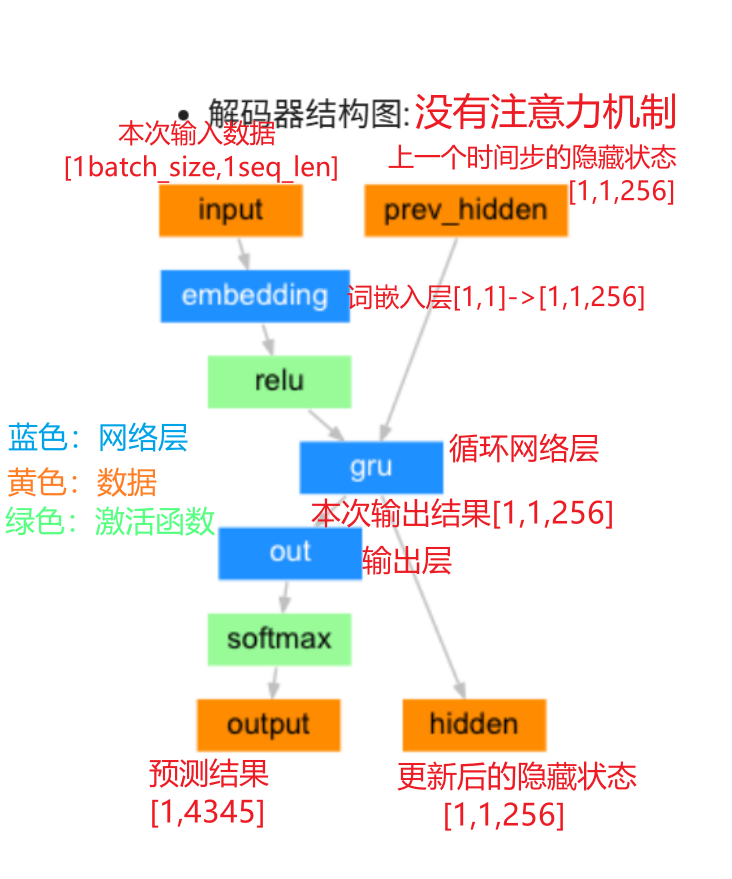

- output[-1]和output[0]的区别

~~~python
import torch

if __name__ == '__main__':
    # 3个词，2条句子，4隐藏状态向量维度
    output = torch.randn(size=(3,2,4))
    print(output)

    print("-"*30)

    output_1 = output[:,-1,:]
    print(output_1)
    print(output_1.shape) # [3,4]

    print("-" * 30)

    output_0 = output[:,0,:]
    print(output_0)
    print(output_0.shape) # [3,4]
~~~


- 代码实现

```python
# 7- 解码器：无注意力机制
class Decoder(nn.Module):
    def __init__(self,fra_vocab_size,hidden_size):
        # 1- 初始化父类
        super().__init__()

        # 2- 设置属性值
        self.fra_vocab_size = fra_vocab_size
        self.hidden_size = hidden_size

        # 3- 搭建网络结构
        # 3.1- 词嵌入层
        self.ebd = nn.Embedding(num_embeddings=self.fra_vocab_size,embedding_dim=self.hidden_size)

        # 3.2- GRU层
        self.gru = nn.GRU(input_size=self.hidden_size,hidden_size=self.hidden_size,num_layers=1,batch_first=True)

        # 3.3- 输出层
        self.output_linear = nn.Linear(in_features=self.hidden_size,out_features=self.fra_vocab_size)

        # 4- 输出层的激活函数
        # CrossEntropyLoss = LogSoftmax + NLLLoss
        self.log_softmax = nn.LogSoftmax(dim=-1)

    def forward(self,input,hidden):
        """
        Decoder前向传播：负责翻译得到法语词
        :param input: 本次输入数据，每次只送一个法语词进来，张量形状：[batch_size,seq_len]，[[一个法语词的词索引]]
        :param hidden: 上一个时间步的隐藏状态，张量形状：[num_layers,batch_size,hidden_size]
        :return:
        """

        # 1- 调用词嵌入层
        embed = torch.relu(self.ebd(input))

        # 2- 调用GRU
        output,hidden = self.gru(embed,hidden)
        print(f"1-->output-->{output.shape}")

        # 3- 调用输出层
        # 3.1- 将output由3维变成2维，[batch_size,seq_len,hidden_size] -> [batch_size,hidden_size]
        """
            output[:,-1,:] 针对文本分类的业务场景。-1表示取最后一个时间步的隐藏状态，文本分类需要对一整条句子的完整信息理解完以后再做分类
            output[:,0,:]  针对文本翻译的业务场景。
        """
        output = output[:,0,:]
        print(f"2-->output[:,0,:]-->{output.shape}")

        # 3.2- 调用
        output = self.log_softmax(self.output_linear(output))
        print(f"3-->output-->{output.shape}")

        return output,hidden

    def init_hidden(self):
        return torch.zeros(size=(1,1,self.hidden_size)).to(device=device)
```

- 代码测试

```python
# 测试解码器
def use_decoder():
    # 1- 准备数据
    dataloader = get_dataloader()

    # 2- 创建模型实例对象
    my_encoder = Encoder(eng_vocab_size=english_word_cnt,input_size=256,hidden_size=256).to(device=device)
    my_decoder = Decoder(fra_vocab_size=franch_word_cnt,hidden_size=256).to(device=device)

    # 3- 前向传播
    for x,y in dataloader:
        # x：一条英语句子，[[词索引1, 词索引2,... ]]
        # y：一条法语句子，[[词索引1, 词索引2,... ]]

        # 3.1- 调用编码器：让模型理解英语句子的完整含义
        h0 = my_encoder.init_hidden()
        encoder_output,hidden = my_encoder(x,h0)

        # 3.2- 调用解码器：每次送入一个词
        for index in range(y.shape[1]):
            # 3.3- 解码器前向传播
            fra_word = y[0][index].reshape(1,-1)
            decoder_output,hidden= my_decoder(fra_word, hidden)

            print(f"法语词词索引{fra_word}，隐藏状态信息{hidden.shape}")

        break
```


#### 搭建解码器带Attention模型

- 流程

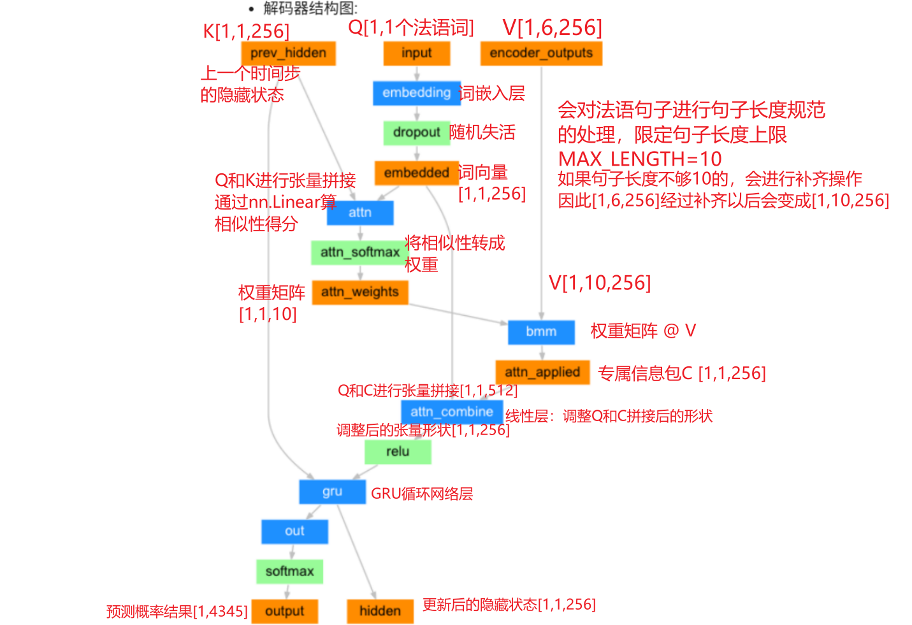

```properties
为什么这里的K来自【解码器上一个时间步隐藏状态】、Q来自【解码器上一个时间步预测结果】，与之前的又不一样？
答：
	1- 这是注意力的另外一种实现方式。该方式可以使用在文本翻译业务场景中
	2- Q、K的这种来源与前面【注意力计算规则】中不一样。但是这种形式可以计算得到注意力。这种机制的核心思想是：在生成当前词时，模型不仅要看“我上一步想到什么”（解码器状态），还要看“我现在要处理什么输入”（当前输入词），然后综合这两者去决定“我该关注编码器的哪个部分”。
	3- 这种设计在Seq2Seq机器翻译模型中非常经典，能同时考虑解码器状态和当前输入词的语义。
```

- 代码实现

```python
# 8- 解码器：有注意力机制
class AttenDecoder(nn.Module):
    def __init__(self,fra_vocab_size,hidden_size):
        # 1- 初始化父类
        super().__init__()

        # 2- 设置属性值
        self.fra_vocab_size = fra_vocab_size
        self.hidden_size = hidden_size      # 有两个作用：1- 词向量维度；2- 隐藏状态向量维度

        # 3- 搭建网络结构
        # 3.1- 词嵌入层
        self.embedding = nn.Embedding(num_embeddings=self.fra_vocab_size,embedding_dim=self.hidden_size)

        # 3.2- Dropout随机失活层
        self.dropout = nn.Dropout(p=0.2)

        # 3.3- 线性层：用来计算QK的相似性
        self.attn = nn.Linear(in_features=self.hidden_size+self.hidden_size,out_features=MAX_LENGTH)

        # 3.4- 线性层：对Q和C拼接后的张量形状进行调整
        self.attn_combine = nn.Linear(in_features=self.hidden_size+self.hidden_size,out_features=self.hidden_size)

        # 3.5- GRU循环网络层
        self.gru = nn.GRU(input_size=self.hidden_size,hidden_size=self.hidden_size,num_layers=1,batch_first=True)

        # 3.6- 输出层
        self.out = nn.Linear(in_features=self.hidden_size,out_features=self.fra_vocab_size)

        # 激活函数
        self.log_softmax = nn.LogSoftmax(dim=-1)

    def forward(self, input, prev_hidden, encoder_outputs):
        """
        :param input: 解码器本次输入数据，也就是Q。张量形状 [batch_size,seq_len]，每次只传一个词进来
        :param prev_hidden: 解码器上一个时间步的隐藏状态，也就是K。张量形状 [num_layers,batch_size,hidden_size]
        :param encoder_outputs: 编码器端所有时间步隐藏状态的拼接，也就是V，而且还做了句子长度规范的处理。张量形状 [batch_size,MAX_LENGTH,hidden_size]
        :return:
        """

        # 1- 调用词嵌入层
        embedded = self.dropout(self.embedding(input))

        # 2- 计算注意力机制
        # 2.1- Q和K拼接
        # embedded就是Q
        # 如果不进行张量形状调整，那么就是num_layers与batch_size进行拼接，业务层面是不合理。
        # 调整K的形状 由 [num_layers,batch_size,hidden_size] -> [batch_size,num_layers,hidden_size]
        K = prev_hidden.transpose(dim0=0,dim1=1)
        # 拼接
        qk_cat = torch.cat(tensors=(embedded,K), dim=-1)

        # 2.2- 通过线性层算QK的相似性
        score = self.attn(qk_cat)

        # 2.3- 相似性转成权重
        attn_weights = torch.softmax(score, dim=-1)

        # 2.4- 得到专属信息包C：权重矩阵和V进行矩阵乘法运算
        # C对应原理图中的attn_applied
        C = torch.bmm(attn_weights, encoder_outputs)

        # 2.5- Q和C拼接
        qc_cat = torch.cat(tensors=(embedded,C),dim=-1)

        # 2.6- 通过线性层调整QC拼接后的张量
        qc_output = torch.relu(self.attn_combine(qc_cat))

        # 3- 调用GRU
        output,hidden = self.gru(qc_output,prev_hidden)

        # 4- 调用输出层
        output = output[:,0,:]
        output = self.log_softmax(self.out(output))

        return output,hidden,attn_weights

    def init_hidden(self):
        return torch.zeros(size=(1,1,self.hidden_size)).to(device=device)
```


### 模型训练

- 基本过程

```properties
整体流程：
    1. 获取数据集加载器对象
    2. 模型初始化
    3. 优化器初始化
    4. 损失函数初始化. 使用 NLLLoss() 负数对数似然损失
    5. 训练参数初始化
    6. 循环训练
        6.1 外层循环, 控制训练轮数
        6.2 内层循环, 遍历数据集的每个样本(即: 每轮具体的训练过程)
            具体训练过程看下面的步骤
        6.3 打印训练日志 (每1000个样本打印一次)
        6.4 记录损失用于绘图(每100个样本记录一次)
    7. 保存模型
    8. 训练结束后, 绘制损失曲线
    9. 训练结束, 返回结果

------------------------------------------------

具体训练过程（针对单条样本）：
	1. 编码阶段, 将输入的序列转换为上下文向量
    2. 解码参数准备
        2.1 构建编码器的输出张量, 用于注意力计算, 形状为: [10, 256]
        2.2 解码器初始化隐藏状态
        2.3 解码器的初始输入
    3. 初始化损失值
    4. 根据概率值决定是否用 Teacher forcing
		4.1 teacher forcing模型: 使用真实标签作为下一步的输入
		4.2 非Teacherforcing模型: 使用上一时间步的预测结果作为下一步的输入
    5. 反向传播 和 参数更新
    6. 返回平均损失
```

- 代码实现

```python
# 9.2- 整体训练过程
def train():
    # 1- 准备数据
    dataloader = get_dataloader()

    # 2- 创建类的实例对象
    # 2.1- 模型实例对象
    my_encoder = Encoder(eng_vocab_size=english_word_cnt,input_size=256,hidden_size=256).to(device=device)
    my_decoder = AttenDecoder(fra_vocab_size=franch_word_cnt,hidden_size=256).to(device=device)
    # 2.2- 优化器实例对象：与具体的实例对象有关，因此要创建单独的两个
    encoder_adam = torch.optim.Adam(params=my_encoder.parameters(),lr=1e-4)
    decoder_adam = torch.optim.Adam(params=my_decoder.parameters(),lr=1e-4)
    # 2.3- 损失函数对象：与具体的实例对象无关，内部只是通过预测和真实值计算差值而已，因此只需要创建一个
    loss = nn.NLLLoss()

    # 3- 设置模式
    my_encoder.train()
    my_decoder.train()

    # 4- 模型训练
    epochs = 1

    avg_loss_list = []  # 用来存储平均损失

    for epoch in range(epochs):
        total_loss_value = 0.0  # 总损失值

        for i,(x_train,y_train) in enumerate(tqdm(dataloader), start=1):
            # 1- 单次训练得到损失值
            loss_value = train_iter(x_train,y_train,my_encoder,my_decoder,encoder_adam,decoder_adam,loss)

            # 2- 更新统计指标
            total_loss_value += loss_value

            # 3- 每隔100个批次记录并且输出一次信息
            if i%100==0:
                # 计算平均损失值
                avg_loss = total_loss_value / i

                avg_loss_list.append(avg_loss)
                print(f"第{epoch+1}轮次，平均损失{avg_loss}")

    # 5- 保存训练好的模型
    torch.save(my_encoder.state_dict(), "model/encoder.pkl")
    torch.save(my_decoder.state_dict(), "model/decoder.pkl")

    # 6- 绘制损失值变化曲线
    plt.plot(avg_loss_list)
    plt.show()
```

- 模型训练内部迭代函数代码实现

```python
# 9.1- 单次训练过程
def train_iter(x,y,my_encoder,my_decoder,encoder_adam,decoder_adam,loss):
    """
    单次样本数据的训练过程
    :param x: 英语句子，张量形状[batch_size,seq_len]
    :param y: 法语句子，张量形状[batch_size,seq_len]
    :param my_encoder: 编码器对象
    :param my_decoder: 解码器对象
    :param encoder_adam: 编码器的优化器
    :param decoder_adam: 解码器的优化器
    :param loss: 损失函数对象
    :return: 平均损失值
    """

    # 1- 调用编码器
    encoder_hidden = my_encoder.init_hidden()
    encoder_output,encoder_hidden = my_encoder(x,encoder_hidden)

    # 2- 调用解码器之前的准备工作
    # 2.1- 句子长度规范化处理，同时也是合并得到V
    # 初始化一个形状[1,10,256]的全0张量
    V = torch.zeros(size=(1,MAX_LENGTH,256), device=device)
    copy_seq_len = min(MAX_LENGTH, x.shape[1])
    V[:, :copy_seq_len, :] = encoder_output[:, :copy_seq_len, :]

    # 2.2- 准备变量
    # 将编码器端最后一个时间步的隐藏状态作为 初始隐藏状态 给到解码器使用
    decoder_hidden = encoder_hidden
    # 损失值
    loss_value = 0.0
    # 获得法语句子中词的个数
    y_seq_len = y.shape[1]
    # 存储法语翻译结果，而且上个时间步的预测结果会作为本次输入数据使用，这称之为自回归
    input_y = torch.tensor([[SOS_TOKEN]], device=device)
    # 教师机制的标识。True：使用教师机制，也就是告诉下个时间步【真实】的法语词内容。反之，把【预测】结果给到下个时间步
    teacher_forcing_flag = True if random.random()<0.5 else False

    # 3- 调用解码器
    if teacher_forcing_flag:
        # 使用教师机制，也就是告诉下个时间步【真实】的法语词内容
        for i in range(y_seq_len):
            # 3.1- 前向传播
            pred_output,decoder_hidden,attn_weights = my_decoder(input=input_y, prev_hidden=decoder_hidden, encoder_outputs=V)

            # 3.2- 计算损失值
            # print(f"y-->{y.shape}")
            # print(f"y[0]-->{y[0].shape}")
            # print(f"y[0][i]-->{y[0][i]}")

            y_true = y[0][i].reshape(1)

            # print(f"y_true-->{y_true.shape}")

            loss_value += loss(pred_output,y_true)

            # 3.3- 告诉下个时间步【真实】的法语词内容
            input_y = y[0][i].reshape(1,-1) # [batch_size,seq_len]

    else:
        # 普通训练机制，把【预测】结果给到下个时间步
        for i in range(y_seq_len):
            # 3.1- 前向传播
            pred_output, decoder_hidden, attn_weights = my_decoder(input=input_y, prev_hidden=decoder_hidden,
                                                                   encoder_outputs=V)

            # 3.2- 计算损失值
            y_true = y[0][i].reshape(1)
            loss_value += loss(pred_output, y_true)

            # 3.3- 获得预测结果的词索引
            pred_word_index = torch.argmax(pred_output, dim=-1)

            # 3.4- 判断是否到了句子的结尾
            if pred_word_index == EOS_TOKEN:
                break

            # 3.5- 告诉下个时间步【预测】的法语词内容
            input_y = pred_word_index.reshape(1, -1)  # [batch_size,seq_len]

    # 4- 反向传播固定代码
    encoder_adam.zero_grad()
    decoder_adam.zero_grad()

    loss_value.sum().backward()

    encoder_adam.step()
    decoder_adam.step()

    return loss_value.item() / y_seq_len
```


### 模型预测

- 基本过程

```properties
1.获取数据
2.数据预处理
3.实例化模型: 编码器和解码器
4.加载模型训练好的参数: model.load_state_dict(torch.load("model_path"))
5.with torch.no_grad():
6.将数据送入模型进行预测（注意:张量的形状变换）
```


- 调用模型预测代码

```python
# 10.2- 完整的预测流程
def use_seq2seq_evaluate():
    # 1- 手动准备未知数据
    my_samplepairs = [
        ['i m impressed with your french .', 'je suis impressionne par votre francais .'],
        ['i m more than a friend .', 'je suis plus qu une amie .'],
        ['she is beautiful like her mother .', 'elle est belle comme sa mere .']
    ]

    # 2- 加载训练好的模型
    my_encoder = Encoder(eng_vocab_size=english_word_cnt,input_size=256,hidden_size=256).to(device=device)
    my_encoder.load_state_dict(torch.load("model/encoder.pkl"))

    my_decoder = AttenDecoder(fra_vocab_size=franch_word_cnt,hidden_size=256).to(device=device)
    my_decoder.load_state_dict(torch.load("model/decoder.pkl"))

    # 3- 设置模式
    my_encoder.eval()
    my_decoder.eval()

    # 4- 预测
    for i,pair in enumerate(my_samplepairs):
        x = pair[0] # 英语句子
        y = pair[1] # 英语句子

        # 4.1- 英语句子转成张量
        x_list = [english_word2index[word] for word in x.split(" ")]
        # 所有的张量数据必须放在同一个硬件设备上，要么同时在GPU，要么同时在CPU
        x_tensor = torch.tensor(x_list, dtype=torch.long, device=device).reshape(1,-1)

        # 4.2- 对单条句子进行评估
        franch_word_list = seq2seq_evaluate(x_tensor,my_encoder,my_decoder)

        # 4.3- 输出结果
        print(f"英语句子 {x}，真实法语句子 {y}，翻译法语句子 {' '.join(franch_word_list)}")
```


- 预测的核心代码

```python
# 10.1- 单条句子的翻译
def seq2seq_evaluate(x_tensor,my_encoder,my_decoder):
    """
    单条句子的翻译
    :param x_tensor: 一条处理后的英语句子，形状[batch_size,seq_len]
    :param my_encoder: 编码器
    :param my_decoder: 解码器
    :return: 翻译的法语词列表
    """

    with torch.no_grad():
        # 1- 调用编码器
        encoder_output,encoder_hidden = my_encoder(x_tensor,my_encoder.init_hidden())

        # 2- 调用解码器之前的准备工作
        # 2.1- 句子长度规范化处理，同时也是合并得到V
        # 初始化一个形状[1,10,256]的全0张量
        V = torch.zeros(size=(1,MAX_LENGTH,256), device=device)
        copy_seq_len = min(MAX_LENGTH, x_tensor.shape[1])
        V[:, :copy_seq_len, :] = encoder_output[:, :copy_seq_len, :]

        # 2.2- 准备变量
        # 将编码器端最后一个时间步的隐藏状态作为 初始隐藏状态 给到解码器使用
        decoder_hidden = encoder_hidden
        # 存储单次的法语翻译结果，而且上个时间步的预测结果会作为本次输入数据使用，这称之为自回归
        input_y = torch.tensor([[SOS_TOKEN]], device=device)
        # 存储所有的翻译法语词
        franch_word_list = []

        # 3- 评估/预测
        for i in range(MAX_LENGTH):
            # 3.1- 前向传播：调用解码器
            decoder_output,decoder_hidden,attn_weights = my_decoder(input=input_y, prev_hidden=decoder_hidden, encoder_outputs=V)

            # 3.2- 获得预测概率最高的那个词的词索引
            pred_fra_index = torch.argmax(decoder_output, dim=-1).item()

            # 3.3- 判断是否遇到了句子的结束标识
            if pred_fra_index == EOS_TOKEN:
                franch_word_list.append("EOS")
                break
            else:
                # 通过索引获得法语词的内容
                fra_word = franch_index2word[pred_fra_index]
                franch_word_list.append(fra_word)

            input_y = torch.tensor([[pred_fra_index]], device=device)

    return franch_word_list
```


