# 第四章 Transformer模型

## 背景介绍【了解】

模型被提出时间

```properties
2017年提出，2018年google发表了BERT模型，使得Transformer架构流行起来，BERT在许多NLP任务上，取得了Soat的成就。

论文地址：https://arxiv.org/pdf/1706.03762
```

模型优势

```properties
1、能够实现并行计算，提高模型训练效率
2、更好的特征提取能力
```

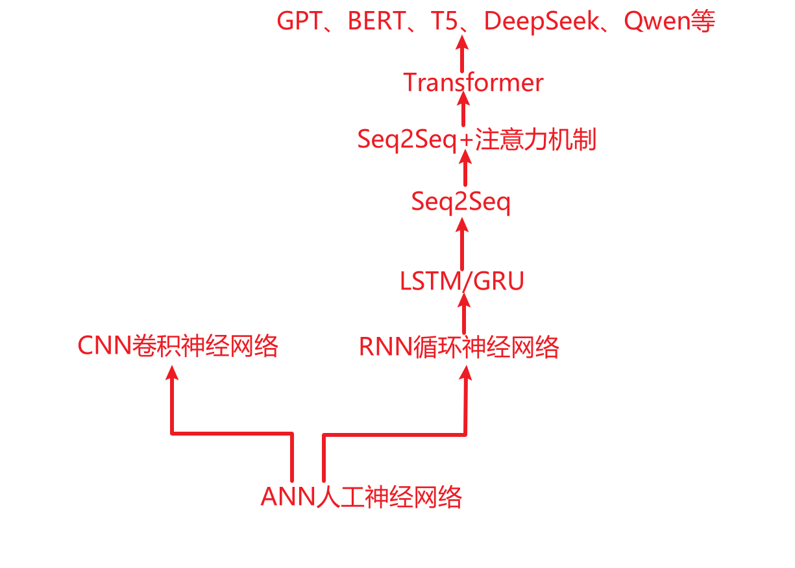


思想间的关系：

~~~properties
Seq2Seq
Seq2Seq+注意力机制
Transformer
2017 《attention is all you need》
2018 Bert
2022 ChatGPT、T5

绝大多数大模型底层的原理都是Transformer
~~~


## Transformer模型架构

### 整体架构【掌握】

组成部分：

```properties
1、输入部分
2、编码器部分
3、解码器部分
4、输出部分
```

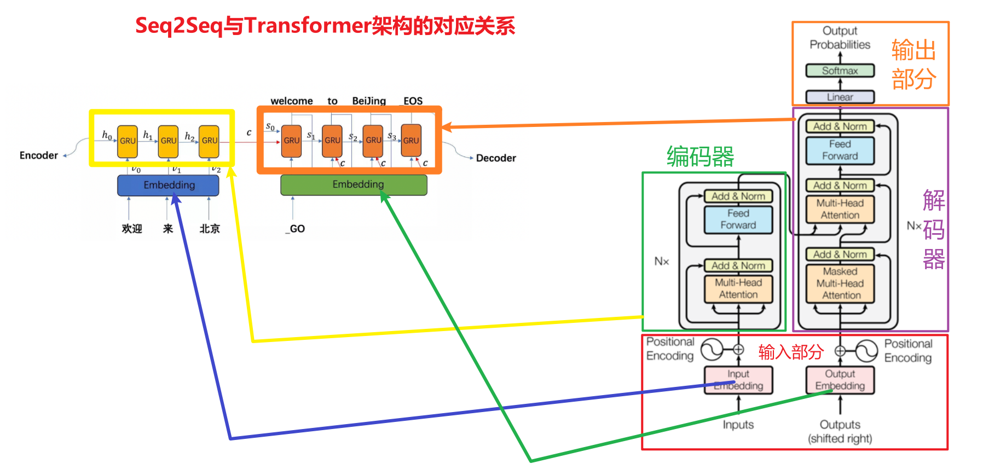

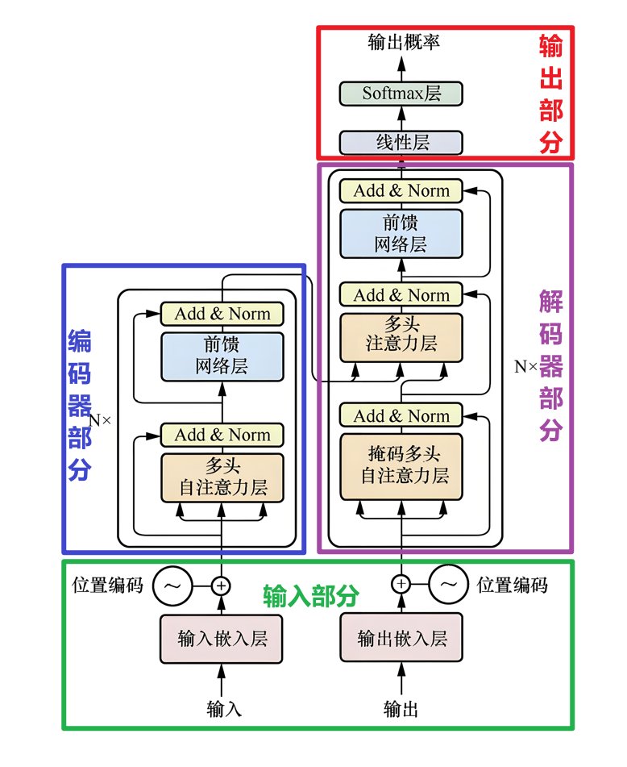

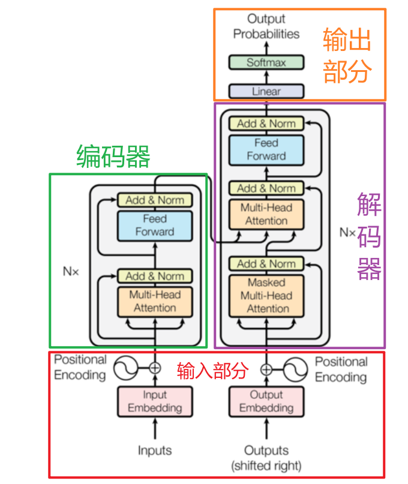

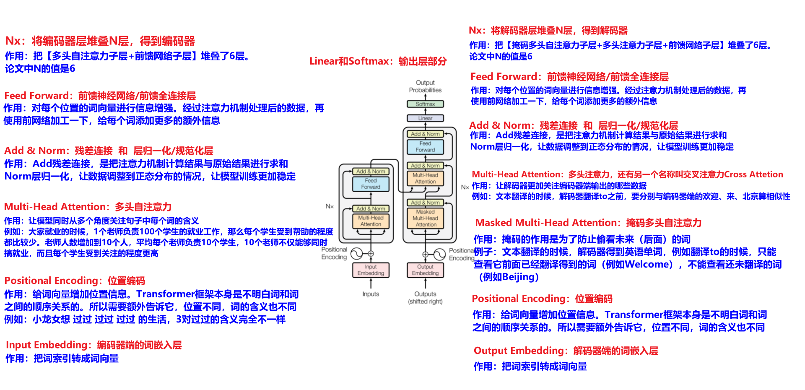

架构概述：

~~~properties
总结流程：
输入文字 -> 嵌入 -> 位置编码 -> 编码器多层加工(注意力+前馈) -> 解码器多层加工(掩码注意力 + 关联编码器 + 前馈) -> 线性层 -> softmax -> 输出概率选词

整个架构的核心：
注意力机制抓关联，多层堆叠挖深度，残差归一化稳训练
~~~

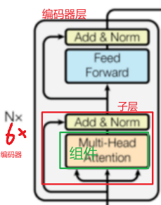

### 输入部分

```properties
Positional Encoding：位置编码
作用：给词向量加'位置信息'
例如：Transformer本身不明白词的顺序，例如：我打你、你打我，所以得额外给每个词向量添加位置信息，告诉模型谁前谁后


Input Embedding：解码器端词嵌入层
作用：把输入的词转成词向量
例如：'你好'->[0.1，-0.3...]
```


### 输出部分

```properties
Softmax：激活层
作用：把线性层输出的数值转成概率，概率总和为1，模型就知道该选哪个词输出


Linear：线性层
作用：把解码器输出的向量，调整成'vocab size词汇表大小'维度，
例如：例如词汇表有1W个词，就把向量变成1W维，每个维度对应1个词的概率分数
```


### 编码器部分

```properties
Nx：重复堆叠
作用：把上面的'多头注意力 + Add&Norm + 前馈网络'重复N次(论文里是6次)
例如：一层不够深，多堆几层，让模型'层层递进'理解文本，从表面语义 ->深层逻辑


Feed Forward：前馈网络
作用：对每个位置的词向量"单独强化特征’
例如：经过注意力层后，再用全连接网络加工一下，给每个词'注入更多细节'，例如：'强化'猫的动物属性，追’的动作属性


Add & Norm：残差连接 + 层归一化
作用：让训练更稳，更高效。层归一化也称之为规范化层
例如：Add是把注意力层的输入和输出加一起，防止信息丢太多。Norm是把数据归一化(数值限制在某个范围)，避免训练时跑偏，梯度消失/爆炸


Multi-Head Attention：多头自注意力层
作用：让模型同时从多个角度关注句子里的词
例如：猫追老鼠'，既要关注'猫"和'追'的关系，也要关注'猫'和'老鼠'的关系，还能对比'猫' 和'老鼠'的关联.
```


### 解码器部分

```properties
Add & Norm + Feed Forward + Nx：
作用：和编码器里的逻辑一样，
     残差连接、归一化保证训练稳定；
     前馈网络强化特征；
     Nx重复堆叠加深模型


Multi-Head Attention：多头注意力层
作用：让解码器'关注编码器输出的内容'
例如：翻译时，解码器生成法语词，盯着处理后的英文词义，确保翻译准确，找对应关系


Masked Multi-Head Attention：掩码多头自注意力层
作用：防止'偷看未来的词'
例如：解码器是一步步生成输出的，只能用'已生成的词'，不能用未生成的词.
```


## 代码开发思路【了解】

### 重点组件

只需要搞清楚如下几个组件的功能、作用和代码开发

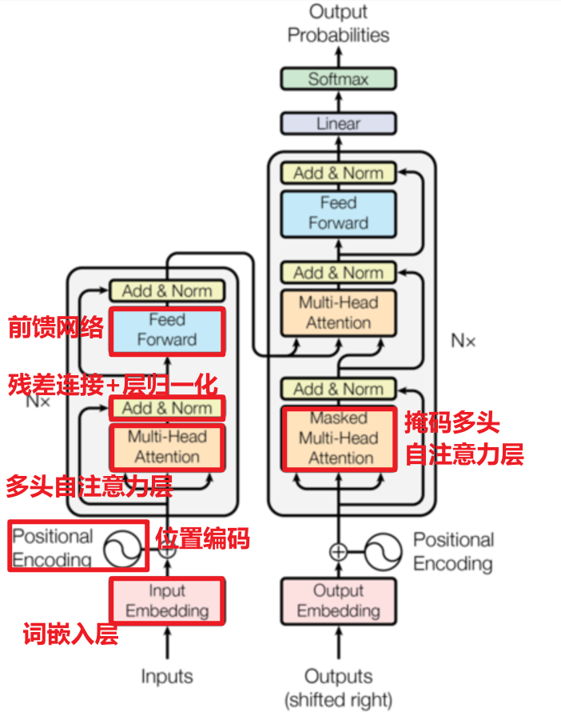


### 具体开发步骤

* 编码器

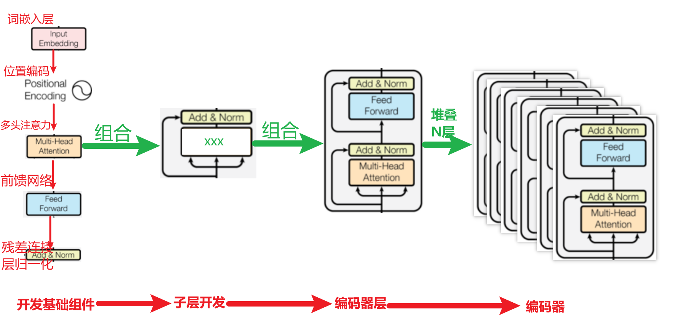


* 解码器

参考编码器的开发过程，大部分地方的功能直接复用。主要是开发【掩码多头自注意力层】


* 输出部分

非常简单，nn.Linear全连接层+Softmax激活函数


* 代码的作用和开发顺序

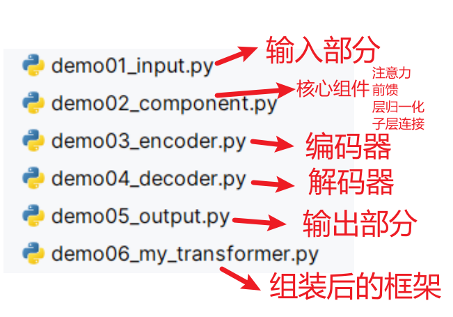

## 输入部分

### 词嵌入层

注意：为什么embedding之后要乘以根号下d_model
- 原因1：为了防止position encoding的信息覆盖我们的word embedding，也就是防止两者的值差距过大。所以进行一个数值增大
- 原因2：符合正态分布


* 代码实现

```python
# 词嵌入层
class Embedding(nn.Module):
    def __init__(self,vocab_size,d_model):
        # 1- 初始化父类
        super().__init__()

        # 2- 设置属性值
        self.vocab_size = vocab_size    # 词汇表大小
        self.d_model = d_model          # 向量维度。本次这里表示 词向量维度

        # 3- 搭建网络结构
        self.ebd = nn.Embedding(num_embeddings=self.vocab_size,embedding_dim=self.d_model)

    def forward(self,input):
        """
            为什么要乘以根号d_model，也就是根号dk？
            答：为了对词向量中的数据进行放大。避免与位置编码的数据进张量加法运算以后，词向量的值过小导致占比少
            但是位置编码和词向量编码的数据地位应该是一样的，不应该出现谁重要而谁不重要的情况
            对应论文的内容：In the embedding layers, we multiply those weights by √dmodel.

            什么情况下词向量中会出现比较小的值？
            答：当d_model很大的时候
        """
        return self.ebd(input) * math.sqrt(self.d_model)
```


* 测试代码

~~~python
# 测试词嵌入层
def use_embedding():
    # 1- 创建实例对象
    embedding = Embedding(vocab_size=1000,d_model=5)
    # embedding = Embedding(vocab_size=1000,d_model=10240)

    # 2- 准备数据
    # 一个批次中有2条句子，每条句子有3个词
    x = torch.tensor([
        [100, 3, 99],
        [888, 777, 5]
    ])

    # 3- 调用得到词向量
    text_tensor = embedding(x)
    print(f"文本张量的形状：{text_tensor.shape}")
    print(f"文本张量的内容：{text_tensor}")
    print(f"文本张量中绝对值的最小值：{text_tensor.abs().min()}")
~~~


### 位置编码

作用

```properties
Transformer编码器或解码器中缺乏位置信息，因此加入位置编码器，将词汇的位置可能代表的不同特征信息和word_embedding进行融合，以此来弥补位置信息的缺失。
```

位置编码器实现方式：三角函数来实现的，sin、cos函数

为什么使用三角函数来进行位置编码

```properties
1、保证同一词汇随着所在位置不同它对应位置嵌入向量会发生变化
2、正弦波和余弦波的值域范围都是1到-1这又很好的控制了嵌入数值的大小, 有助于梯度的快速计算
```

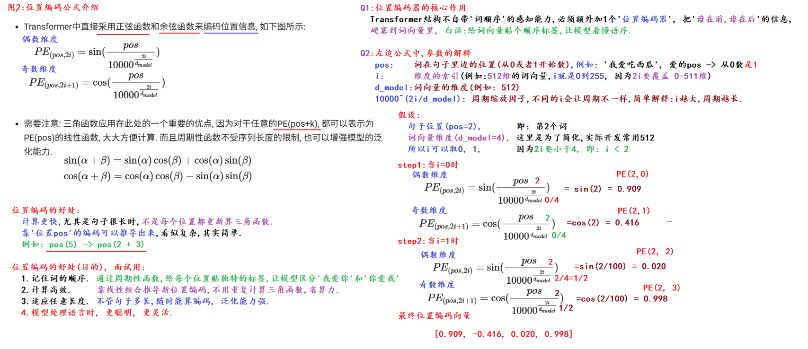


* 代码实现

```python
class PositionalEncoding(nn.Module):
    def __init__(self,dropout_p,max_len,d_model):
        # 1- 初始化父类
        super().__init__()

        # 2- 设置属性值
        self.dropout_p = dropout_p  # 随机失活概率
        self.max_len = max_len      # 句子规范化处理的长度上限
        self.d_model = d_model      # 词向量维度

        # 3- 创建随机失活层
        self.dropout = nn.Dropout(p=self.dropout_p)

        # 4- 定义位置编码的计算规则：也就是实现公式
        # 4.1- 初始化pe：目前的形状是[60,5]
        pe = torch.zeros(size=(self.max_len,self.d_model))
        # 4.2- 得到pos的取值区间：arange是左闭右开的区间
        pos = torch.arange(start=0,end=max_len,step=1).unsqueeze(dim=-1) # 张量形状[60,1]
        # 4.3- 得到1/分母
        div_term = 1/(10000**(torch.arange(start=0,end=d_model,step=2).float()/self.d_model))
        # 4.4- 得到正弦和余弦里面的内容
        value = pos * div_term
        # 4.5- 分别计算：2i->正弦；2i+1->余弦
        pe[:, 0::2] = torch.sin(value)
        pe[:, 1::2] = torch.cos(value)

        # 4.6- 将pe升维为三维：也就是 [60,5]->[1,60,5]
        pe = pe.unsqueeze(dim=0)

        # 4.7- 将pe注册到缓存中，通过它来不断的更新计算得到每个词的位置编码信息，后面可以直接使用pe
        self.register_buffer("pe",pe)

    def forward(self,embed):
        """
        位置编码需要根据词向量来计算；然后再实现位置编码 加上 词向量
        :param embed: 词向量
        :return:
        """

        """
            为什么要对pe进行切片操作？
            答：因为传进来的embed中词的个数不一定够max_len的长度。举例如下：
            embeb中有10个词，词向量维度是5，句子的条数有2条，那么embed的形状[2,10,5]
            对应pe的形状[2,60,5]。它们两个的形状不相同，因此不能进行加法运算，所以需要
            将pe的形状进行切片操作，也就是将有意义的前10个词的位置编码信息取出来
        """
        seq_len = embed.shape[1]
        result = embed + self.pe[:, :seq_len, :]

        print(f"1--embed的内容-->{embed}")
        print(f"2--pe的内容-->{self.pe[:, :seq_len, :]}")
        return self.dropout(result)
```


* 测试代码

~~~python
def use_positional_encoding():
    # 注意：词向量维度只能是偶数，这个与位置编码中i的取值区间有关

    # 1- 创建实例对象
    embedding = Embedding(vocab_size=1000, d_model=512)

    # 2- 准备数据
    # 一个批次中有2条句子，每条句子有3个词
    x = torch.tensor([
        [100, 3, 99, 666],
        [888, 777, 5, 555]
    ])

    # 3- 调用得到词向量
    text_tensor = embedding(x)

    # 4- 调用位置编码
    # 4.1- 创建类的实例对象
    pe_obj = PositionalEncoding(dropout_p=0.2,max_len=60,d_model=512)
    # 4.2- 调用
    pe_and_ebd = pe_obj(text_tensor)

    print(f"最终的形状：{pe_and_ebd.shape}")
    print(f"最终的内容：{pe_and_ebd}")

    return pe_and_ebd

# 可视化位置编码
def plot_position():
    # 1. 实例化位置编码器.
    my_position = PositionalEncoding(dropout_p=0, max_len=100, d_model=20)

    # 2. 生成全0的输入, 观察位置编码的模式.
    # (1, 100, 20) -> 批次大小, 句子长度, 词嵌入维度
    embed = torch.zeros(1, 100, 20)
    y = my_position(embed)

    # 3. 设置图表大小.
    plt.figure(figsize=(20, 15))
    # 绘制位置编码第4到第7列, 100个词的  [4, 5, 6, 7]
    """
        图形的信息解释：
            x轴：词的索引，目前总共有100个词
            y轴：位置编码值
    """
    plt.plot(np.arange(100), y[0, :, 4:8].detach().numpy())
    plt.legend([f'dim {p}' for p in [4, 5, 6, 7]])
    plt.show()
~~~

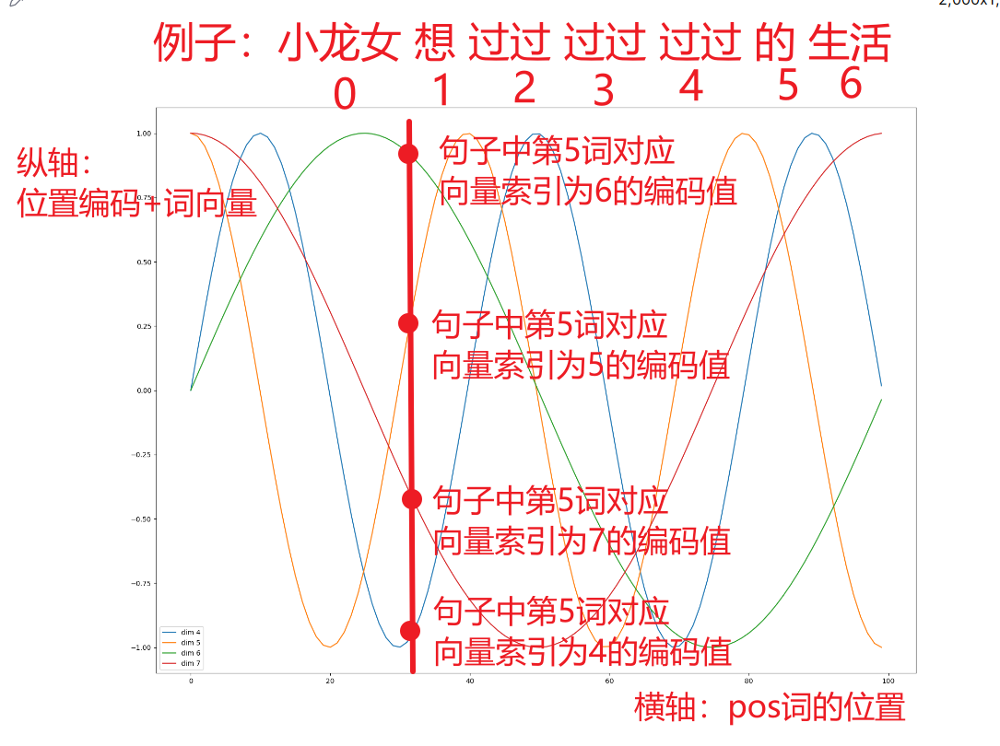


## 编码器部分

### 掩码张量

作用

```properties
掩码：掩就是遮掩、码就是张量。掩码本身需要一个掩码张量，掩码张量的作用是对另一个张量进行数据信息的掩盖。一般掩码张量是由0和1两种数字组成，至于是0对应位置或是1对应位置进行掩码，可以自己设定
```

* PyTorch版本

~~~python
# 使用PyTorch实现掩码。【掌握】
"""
    总结：
        1- 上三角掩码：右上角的值为1，左下角的值为0
        2- 下三角掩码：右上角的值为0，左下角的值为1
        3- 相同的规律：对角线的时候diagonal为0；如果是正数，并且越来越大，那么往右上角移动；反之往左下角移动；diagonal的取值超过范围不会报错
        4- 【掌握】掩码的作用：为了防止解码器端当前时间步偷看后面时间步的数据，你只能看到你前面时间步已经预测出来的数据。核心是防止模型训练效果不好
        5- 【掌握】代码：torch.triu(t,diagonal=0)
"""

import torch
def torch_mask():
    # 创建初始张量
    t = torch.ones(size=(5,5))
    print(f"原始张量：{t}")

    # 进行掩码操作
    # 上三角掩码
    u_0_mask = torch.triu(t,diagonal=0)
    print(f"上三角掩码0：{u_0_mask}")

    u_1_mask = torch.triu(t, diagonal=1)
    print(f"上三角掩码1：{u_1_mask}")

    u__1_mask = torch.triu(t, diagonal=-1)
    print(f"上三角掩码_1：{u__1_mask}")

    u_n_mask = torch.triu(t, diagonal=1000)
    print(f"上三角掩码n：{u_n_mask}")

    print("-"*30)

    # 下三角掩码
    l_0_mask = torch.tril(t, diagonal=0)
    print(f"下三角掩码0：{l_0_mask}")

    l_1_mask = torch.tril(t, diagonal=1)
    print(f"下三角掩码1：{l_1_mask}")

    l__1_mask = torch.tril(t, diagonal=-1)
    print(f"下三角掩码-1：{l__1_mask}")
~~~


* numpy版本

~~~python
import numpy as np
def np_mask():
    # 1- 准备数据
    arr = np.ones(shape=(5,5))

    # 2- 上三角掩码
    # k和PyTorch中diagonal参数的作用完全一样
    u_result = np.triu(arr,k=0)
    print(f"上三角掩码0：\n{u_result}")

    u_result = np.triu(arr, k=1)
    print(f"上三角掩码1：\n{u_result}")

    u_result = np.triu(arr, k=-1)
    print(f"上三角掩码-1：\n{u_result}")

    # 3- 下三角掩码
    l_result = 1 - u_result
    print(f"下三角掩码：\n{l_result}")

    l_result = np.tril(arr,k=0)
    print(f"下三角掩码0：\n{l_result}")

    l_result = np.tril(arr, k=1)
    print(f"下三角掩码1：\n{l_result}")

    l_result = np.tril(arr, k=-1)
    print(f"下三角掩码-1：\n{l_result}")
~~~


* 掩码张量的可视化

~~~python
# 掩码张量的可视化.
def dm03_test_mask():
    # 简单说(总结): 纵向选'当前位置', 横向看'能看哪些位置', 0(黄色): 遮挡, 1(紫色): 不遮挡
    plt.figure(figsize=(5, 5))
    plt.imshow(demo2(20)[0])
    plt.show()
~~~


### 注意力机制【掌握】

#### 计算规则

```properties
自注意力机制，规则：Q乘以K的转置，然后除以根号下d_k，然后再进行Softmax，最后和V进行张量矩阵相乘
如果是自注意力，那么Q、K、V的值完全相同
```


#### 注意力计算

扩展知识：点积和点乘

点积：等同于矩阵乘法，可以使用matmul函数进行计算，也可以使用dot函数进行计算。在注意力机制场景下，一般使用matmul

点乘：两个张量的形状要完全一样。对应坐标位置元素相乘

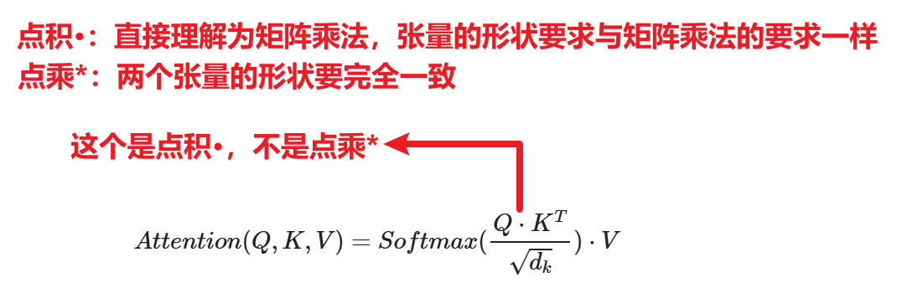


* 代码实现

```properties
import copy
import math

import torch
from torch import Tensor
import torch.nn as nn
from demo01_input import *

# 根据注意力计算公式算注意力
def attention(query:Tensor,key:Tensor,value:Tensor,mask=None,dropout=None):
    """
    注意力计算方法
    该方法能够实现如下3种注意力的计算:
    1- 编码器端 多头自注意力：query=key=value，mask=None。编码器端大多数不需要掩码
    2- 解码器端 掩码多头自注意力：query=key=value，mask不为空的时候
    3- 解码器端 掩码多头注意力（交叉注意力）：query和key、value不相等，mask=None
    :param query: 查询张量，形状：[batch_size每个批次中有多少条句子,seq_len句子中词的个数,d_model向量维度]
    :param key: 键张量，形状：[batch_size,seq_len,d_model]
    :param value: 值张量，形状：[batch_size,seq_len,d_model]
    :param mask: 掩码张量，形状：[batch_size,seq_len,seq_len]，使用过程中会自动进行广播机制
    :param dropout: 随机失活层对象
    :return:
    """

    # 1- 获得dk，也就是d_model，也就是向量维度
    dk = query.shape[-1]

    # 2- Q和K的转置进行矩阵乘法运算，再除以根号下dk。得到了相似性得分
    # 注意：key.transpose需要交换的是张量中最后两个形状的位置，不要从左往右正着数索引，要倒着来
    scores = torch.matmul(query, key.transpose(dim0=-1,dim1=-2)) / math.sqrt(dk)

    # 3- 使用掩码
    if mask is not None:
        # 为什么要使用-1e9次方对掩码的地方进行填充呢？因为为了让后面计算softmax权重值的时候，掩码地方的权重被计算为0
        scores = scores.masked_fill(mask==1, value=-1e9)

    # 4- 将相似性得分转成权重矩阵
    weighted = torch.softmax(scores, dim=-1)

    # 5- 【可选】随机失活
    if dropout is not None:
        weighted = dropout(weighted)

    # 6- 权重矩阵和V进行矩阵乘法，得到专属信息包C
    C = torch.matmul(weighted,value)

    return C,weighted
```


* 测试代码

~~~python
# 注意力计算测试
def use_attention():
    # 1- 输入数据，得到经过词嵌入层和位置编码以后的数据
    pe_ebd = use_positional_encoding()

    dropout = nn.Dropout(p=0.2)

    # 2- 测试：编码器端 多头自注意力机制
    query=key=value=pe_ebd
    C,weighted = attention(query,key,value,dropout=dropout)
    print(f"编码器端 多头自注意力机制C：{C.shape}")
    print(f"编码器端 多头自注意力机制weighted：{weighted.shape}")
    print(f"编码器端 多头自注意力机制weighted：{weighted.sum()}")


    # 3- 测试：解码器端 掩码多头自注意力机制
    mask = torch.triu(torch.ones(size=(2,4,4)), diagonal=1)
    query=key=value=pe_ebd
    C,weighted = attention(query,key,value,mask=mask,dropout=dropout)
    print(f"解码器端 多头自注意力机制C：{C.shape}")
    print(f"解码器端 多头自注意力机制weighted：{weighted.shape}")
    print(f"解码器端 多头自注意力机制weighted：{weighted.sum()}")
~~~


### 多头注意力机制【掌握】

概念

```properties
多头的好处：
	1- 能够让模型进行并行计算，提高运行效率
	2- 多个头来同时处理数据，那么模型对数据的理解、学习会更好，模型整体效果会更好
```

* 多头注意力机制原理图

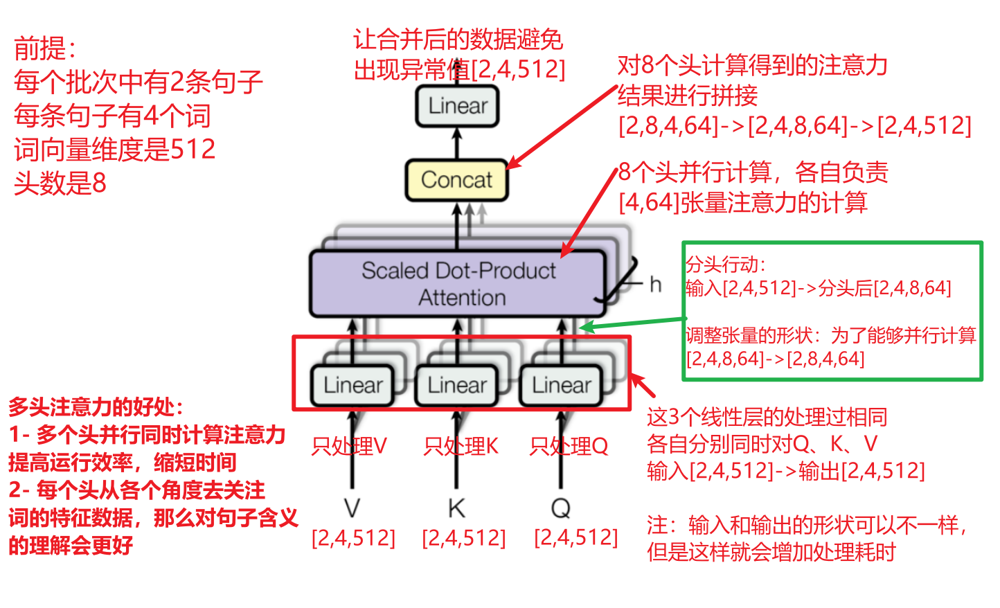


* 代码实现

```properties
def clones(module_obj, cnt):
    """
    创建指定个数的实例对象，对象之间是深拷贝的关系
    :param module_obj: 需要拷贝的对象
    :param cnt: 拷贝的个数
    :return:
    """
    # 语法格式  nn.ModuleList([copy.deepcopy(拷贝对象) for _ in range(拷贝个数)])
    return nn.ModuleList([copy.deepcopy(module_obj) for _ in range(cnt)])

# 多头注意力
class MultiHeadAttention(nn.Module):
    def __init__(self,d_model,head,dropout_p=0.1):
        # 1- 确保张量维度能够被头数整除
        assert d_model%head==0

        # 2- 初始化父类
        super().__init__()

        # 3- 设置属性值
        self.d_model = d_model  # 向量维度
        self.head = head        # 多头的头数
        self.head_dim = d_model // head # 每个头要各自处理的向量维度。例如：512//8=64
        self.dropout = nn.Dropout(p=dropout_p)
        self.weighted = None    # 权重矩阵

        # 4- 创建线性网络结构
        """
            创建的4个线性层的作用：
                第1个线性层：分头行动前，专门用来处理query数据
                第2个线性层：分头行动前，专门用来处理key数据
                第3个线性层：分头行动前，专门用来处理value数据
                第4个线性层：分头行动后，对多个头拼接后的张量数据进行线性调整，对形状、元素值进行调整，避免出现异常值，让模型训练更加稳定
        """
        self.linear_list = clones(nn.Linear(in_features=d_model,out_features=d_model), 4)

    def forward(self,query,key,value,mask:Tensor=None):
        """
        先分头，然后再调用注意力计算方法
        :param query: 查询张量，形状：[batch_size每个批次中有多少条句子,seq_len句子中词的个数,d_model向量维度]
        :param key: 键张量，形状：[batch_size,seq_len,d_model]
        :param value: 值张量，形状：[batch_size,seq_len,d_model]
        :param mask: 掩码张量，形状：[head,seq_len,seq_len]。注意第一个维度代表的是头数，使用过程中会自动进行广播机制
        :return:
        """

        # 1- 掩码升维处理：[batch_size,seq_len,seq_len] -> [1,batch_size,seq_len,seq_len]
        # 添加的形状虽然是1，但是内部可以自动进行广播机制
        if mask is not None:
            mask.unsqueeze_(dim=0)

        # 2- 获得batch_size的值
        batch_size = query.shape[0]

        # 3- 前3个线性层分别用来处理query、key、value
        # 方式一：分开版的写法
        # 格式[(第1个线性层, query), (第2个线性层, key), (第3个线性层, value)]
        # model_and_data_pair = list(zip(self.linear_list, (query,key,value)))
        # transpose_output_list = []
        # for model,data in model_and_data_pair:
        #     # 线性层对对应的数据进行处理
        #     model_output = model(data)
        #
        #     # 调整形状：先分头，然后交换位置
        #     # [2,4,512] -> [2,4,8,64] -> [2,8,4,64]
        #     transpose_output = model_output.reshape(batch_size,-1,self.head,self.head_dim).transpose(1,2)
        #     transpose_output_list.append(transpose_output)
        #
        # new_query, new_key, new_value = transpose_output_list

        # 方式二：合并版的写法
        new_query, new_key, new_value = [
            model(data).reshape(batch_size,-1,self.head,self.head_dim).transpose(1,2)
            for model,data in list(zip(self.linear_list, (query,key,value)))
        ]

        # 4- 多个头分别计算注意力
        C,weighted = attention(new_query, new_key, new_value, mask, dropout=self.dropout)
        self.weighted = weighted

        # 5- 对多个计算后的结果进行”拼接“，实际也就是要将张量的形状重新调整回[2,4,512]
        # [2,8,4,64] -> [2,4,8,64] -> [2,4,512]
        result = C.transpose(1,2).reshape(batch_size,-1,self.head*self.head_dim)

        # 6- 使用最后一个线性层对多头拼接后的数据进行调整
        return self.linear_list[-1](result)
```


* 测试代码

~~~python
def use_multi_head_attention():
    # 1- 调用词嵌入层和位置编码的数据
    pe_ebd = use_positional_encoding()

    multi_head_atten = MultiHeadAttention(d_model=512,head=8)

    # 2- 测试：编码器端 多头自注意力机制
    query=key=value=pe_ebd
    encoder_result = multi_head_atten(query,key,value)
    print(f"编码器端 多头自注意力机制：{encoder_result.shape}")

    # 3- 测试：解码器端 掩码多头自注意力机制
    query = key = value = pe_ebd
    mask = torch.triu(torch.ones(size=(8,4,4)), diagonal=1)
    decoder_result = multi_head_atten(query, key, value, mask)
    print(f"解码器端 掩码多头自注意力机制：{decoder_result.shape}")
~~~


### 前馈网络

概念：前馈网络用来增强模型的拟合能力，内部包含两个全连接层


* 代码实现

```properties
# 前馈网络
class FeedForward(nn.Module):
    def __init__(self,d_model,enlarge_dim,dropout_p=0.1):
        # 1- 初始化父类
        super().__init__()

        # 2- 设置属性值
        self.d_model = d_model  # 输入和输出的向量维度
        self.enlarge_dim = enlarge_dim    # 放大的向量维度
        self.dropout_p = dropout_p    # 随机失活概率

        # 3- 搭建网络结构
        # 3.1- 第1层线性层：用来将输入的向量放大。例如：512->1024
        self.linear_1 = nn.Linear(in_features=self.d_model,out_features=self.enlarge_dim)

        # 3.2- Dropout随机失活层
        self.dropout = nn.Dropout(p=self.dropout_p)

        # 3.3- 第2层线性层：用来将放大后的向量进行浓缩变小。例如：1024->512
        self.linear_2 = nn.Linear(in_features=self.enlarge_dim,out_features=self.d_model)

    def forward(self,data):
        """
        不管传进来的是什么数据，只关心将数据先放大再缩小
        :param data:
        :return:
        """
        """
            为什么使用ReLU激活函数？
            答：
                1- 不是必须要使用ReLU，可以使用其他的
                2- 原始的Transformer论文中用的是ReLU，因为正半轴的导数值固定为1，计算公式简单效率高
        """
        return self.linear_2(self.dropout(torch.relu(self.linear_1(data))))
```


### 层归一化

作用

```properties
随着网络深度的增加，模型参数会出现过大或过小的情况，进而可能影响模型的收敛，因此进行规范化，将参数规范致某个特征范围内，辅助模型快速收敛。
```

代码实现

```properties
# 层归一化/规范化层：数据经过多层的处理以后，会出现异常值，可能会导致梯度消失或梯度爆炸。
# 因此通过层归一化的处理，将数据调整到正态（高斯）分布的情况，让模型训练稳定
class LayerNorm(nn.Module):
    def __init__(self,d_model):
        # 1- 初始化父类
        super().__init__()

        # 2- 设置属性值
        self.d_model = d_model  # 向量维度

        # 3- 定义线性回归公式y=kx+b中的k和b
        """
            1- 为什么k和b的个数与向量维度d_model相同？
            答：d_model表示的是向量维度，而向量维度中每个元素代表一个特征值，而每列特征有自己的权重，因此个数要相同
            
            2- 为什么要用nn.Parameter()包起来？
            答：
                2.1- 如果不用nn.Parameter()包起来，那么变量的值永远不会发生变化
                2.2- 如果用nn.Parameter()包起来，会受到optimizer.step()代码的更新，值会受到反向传播的调整
        """
        self.k = nn.Parameter(torch.ones(self.d_model))
        self.b = nn.Parameter(torch.zeros(self.d_model))

        # 4- 定义小常数：为了防止分母为0
        self.eps = 1e-6

    def forward(self,data:Tensor):
        """
        不关心传进来的data数据来自哪里，只负责对数据进行标准化处理
        :param data:
        :return:
        """
        # 1- 计算均值
        """
            参数解释：
                dim=-1：对最后一个维度进行计算
                keepdim=True：计算后的张量维度数不变。例如：之前是3维，那么计算后也是3维，举例：[2,4,512] -> [2,4,1]
        """
        mean = data.mean(dim=-1,keepdim=True)

        # 2- 计算标准差
        std = data.std(dim=-1,keepdim=True)

        # 3- 对数据进行标准化处理：也就是实现 y=k((x-mean)/std)+b
        """
            为什么要自己实现线性回归的过程，而不使用nn.Linear来实现？
            答：因为我们是对每个批次的数据进行单独的线性回归的处理，然后每个批次数据的权重k和偏置b是不相同的
            这块内容的依据：https://arxiv.org/pdf/1607.06450论文的【3 Layer normalization】
        """
        return self.k * ((data-mean)/(std+self.eps)) + self.b
```


### 子层连接结构

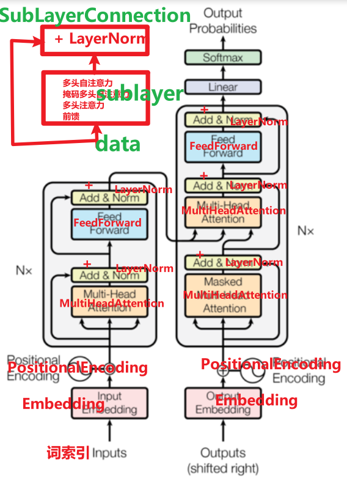

* 代码实现

```properties
# 子层连接对象
"""
    覆盖的组合有如下这些：
        编码器端
            多头自注意力子层
                sublayer_obj多头注意力类的实例对象 + 残差连接 + 层归一化
            前馈网络子层
                sublayer_obj前馈网络类的实例对象 + 残差连接 + 层归一化
        
        解码器端
            掩码多头自注意力子层
                sublayer_obj多头注意力类的实例对象 + 残差连接 + 层归一化
            多头注意力子层
                sublayer_obj多头注意力类的实例对象 + 残差连接 + 层归一化
            前馈网络子层
                sublayer_obj前馈网络类的实例对象 + 残差连接 + 层归一化
"""
class SublayerConnection(nn.Module):
    def __init__(self,d_model,dropout_p=0.2):
        # 1- 初始化父类
        super().__init__()

        # 2- 设置属性值
        self.d_model = d_model
        self.dropout_p = dropout_p

        # 3- 创建层归一化对象
        """
            为什么要创建层归一化对象？
            答：因为每个子层都需要有层归一化对象
        """
        self.layer_norm = LayerNorm(d_model=self.d_model)

        # 4- 创建随机失活层
        self.dropout = nn.Dropout(p=self.dropout_p)

    def forward(self, data, sublayer):
        """
        :param data: 子层需要处理的数据
        :param sublayer: 子层中具体的处理对象的前向传播，例如：多头注意力类的实例对象、前馈网络类的实例对象
        :return:
        """

        # 写法一：Transformer原版论文中的写法， 子组件处理 -> 随机失活层 -> 残差连接 -> 层归一化
        """
            子组件处理：sublayer_obj(data)，底层自动调用我们自己写的forward前向传播方法
            随机失活层：self.dropout(sublayer_obj(data))
            残差连接：+ data
            层归一化：self.layer_norm
        """
        # result = self.layer_norm(self.dropout(sublayer_obj(data)) + data)

        # 写法二：推荐。目前主流大模型中的写法， 层归一化 -> 子组件处理 -> 随机失活层 -> 残差连接
        """
            层归一化：self.layer_norm(data)
            子组件处理：sublayer_obj(self.layer_norm(data))，底层自动调用我们自己写的forward前向传播方法
            随机失活层：self.dropout
            残差连接：+ data
            
            为什么目前主流大模型将层归一化放在了最前面？
            答：放在最前面是为了将之前处理得到的数据调整到符合正态分布的情况，避免出现异常值，让模型训练稳定
        """
        result = self.dropout(sublayer(self.layer_norm(data))) + data

        return result
```


* 子层测试代码

~~~python
# 测试子层连接对象
def use_SublayerConnection():
    # 1- 数据首先经过词嵌入层和位置编码的处理
    data = use_positional_encoding()
    d_model = 512
    # 2- 多头注意力子层测试
    # 2.1- 创建子组件类的实例对象，并且调用forward前向传播方法。也就是创建sublayer_obj
    # 方式一：使用自定义函数的方式实现
    def sublayer_forward_fn(input_data):
        # 创建子组件类的实例对象
        atten_obj = MultiHeadAttention(d_model,head=8)
        # 调用forward前向传播方法
        return atten_obj(query=input_data,key=input_data,value=input_data)

    # 2.2- 创建SublayerConnection类的实例对象
    sublayerConnection = SublayerConnection(d_model)

    # 2.3- 调用SublayerConnection中的前向传播方法
    # 注意：只能传递方法名称，不能带小括号
    atten_result = sublayerConnection(data, sublayer_forward_fn)
    print(f"演示 编码器端 多头自注意力子层：{atten_result.shape}")

    # 3- 前馈网络子层测试
    # 3.1- 创建SublayerConnection类的实例对象
    sublayerConnection = SublayerConnection(d_model)

    # 3.2- 调用SublayerConnection中的前向传播方法
    # 方式二：使用lambda表达式的方式实现
    ff_result = sublayerConnection(atten_result, lambda input_data:FeedForward(d_model,enlarge_dim=1024)(data=input_data))
    print(f"演示 编码器端 前馈网站子层：{ff_result.shape}")
~~~

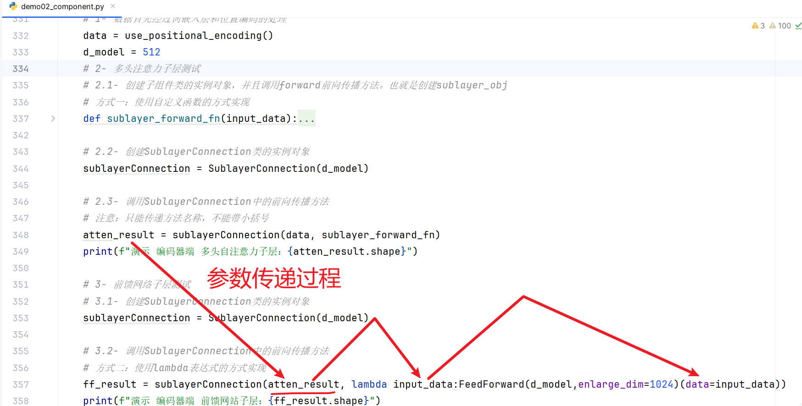


### 编码器层

作用

```properties
每个编码器层完成一次对输入的特征提取过程, 即编码过程.
```

代码实现

```properties
"""
    编码器 由 6层编码器层 组成，就是隐藏层有6层，它们的关系是串行的关系
        每个编码器层由如下的2个子层组成
            多头自注意力子层：多头自注意力 + 残差连接 + 层归一化
            前馈网络子层：前馈网络 + 残差连接 + 层归一化
"""

from demo02_component import *

class EncoderLayer(nn.Module):
    def __init__(self,d_model,dropout_p,feed_forward_obj, multi_head_self_atten_obj):
        # 1- 初始化父类
        super().__init__()

        # 2- 设置属性值
        self.d_model = d_model
        self.dropout_p = dropout_p
        self.feed_forward_obj = feed_forward_obj                    # FeedForward类的实例对象
        self.multi_head_self_atten_obj = multi_head_self_atten_obj  # MultiHeadAttention类的实例对象

        # 3- 创建 多头自注意力子层：多头自注意力 + 残差连接 + 层归一化
        self.multi_head_self_atten_sublayer = SublayerConnection(d_model=self.d_model, dropout_p=self.dropout_p)

        # 4- 创建 前馈网络子层：前馈网络 + 残差连接 + 层归一化
        self.feed_forward_sublayer = SublayerConnection(d_model=self.d_model, dropout_p=self.dropout_p)

    def forward(self, data):

        # 1- 先调用 多头自注意力子层
        atten_result = self.multi_head_self_atten_sublayer(
            data,
            lambda input_data: self.multi_head_self_atten_obj(query=input_data,key=input_data,value=input_data)
        )

        # 2- 再调用 前馈网络子层
        ff_result = self.feed_forward_sublayer(
            atten_result,
            lambda input_data: self.feed_forward_obj(data=input_data)
        )

        return ff_result
```

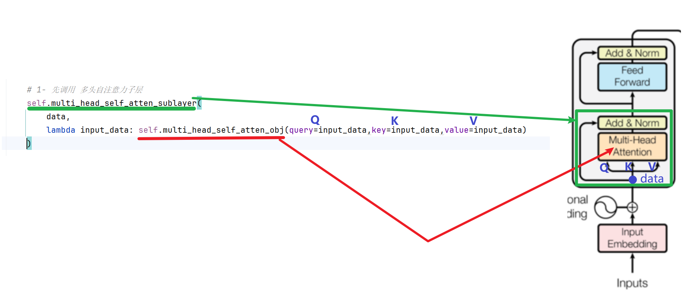

### 编码器

* 代码实现

```properties
class Encoder(nn.Module):
    def __init__(self,encoder_layer_obj,N=6):
        # 1- 初始化父类
        super().__init__()

        # 2- 设置属性值
        self.encoder_layer_obj = encoder_layer_obj  # EncoderLayer类的实例对象
        self.N = N  # 编码器层堆叠N层，默认是6

        # 3- 创建N个编码器层
        self.encoder_layer_list = clones(self.encoder_layer_obj, self.N)

        # 4- 【可选】创建层归一化：防止前面的网络层处理以后出现异常值
        self.layer_norm = LayerNorm(d_model=encoder_layer_obj.d_model)

    def forward(self,data):

        # 1- 依次也就是串行调用6层编码器层
        for layer_obj in self.encoder_layer_list:
            # 注意：处理前后的数据变量名称【必须】保持一致，如果不一致，那么6层编码器层只有最后一层才有价值
            data = layer_obj(data)

        # 2- 调用层归一化
        result = self.layer_norm(data)

        return result
```


* 编码器完整测试代码

~~~python
# 测试编码器
def use_encoder():
    # 1- 调用词嵌入层和位置编码
    pe_ebd = use_positional_encoding()

    d_model = 512
    dropout_p = 0.1

    # 2- 创建编码器实例对象
    # 2.1- 创建 多头自注意力 实例对象
    atten_obj = MultiHeadAttention(d_model=d_model,head=8,dropout_p=dropout_p)
    # 2.2- 创建 前馈网络 实例对象
    ff_obj = FeedForward(d_model=d_model,enlarge_dim=1024,dropout_p=dropout_p)
    # 2.3- 创建 编码器层 实例对象
    encoder_layer_obj = EncoderLayer(d_model=d_model,dropout_p=dropout_p,feed_forward_obj=ff_obj,multi_head_self_atten_obj=atten_obj)
    # 2.4- 创建 编码器 实例对象
    encoder_obj = Encoder(encoder_layer_obj=encoder_layer_obj, N=6)

    # 3- 调用编码器的前向传播
    result = encoder_obj(data=pe_ebd)

    print(f"编码器处理后的结果：{result.shape}")

    return result
~~~


## 解码器部分

### 解码器层

作用

```properties
作为解码器的组成单元, 每个解码器层根据给定的输入向目标方向进行特征提取操作
```

代码实现

```properties
"""
    解码器 由 6层解码器层 组成。6层解码器层之间是串行的关系
    
    解码器层由如下3个子层组成
        掩码多头自注意力子层：掩码多头自注意力mask_multi_head_self_atten_obj + 残差连接 + 层归一化
        多头注意力子层（交叉注意力子层）：多头注意力multi_head_atten_obj + 残差连接 + 层归一化
        前馈网络子层：前馈网络feed_forward_obj + 残差连接 + 层归一化
"""

from demo03_encoder import *

# 解码器层
class DecoderLayer(nn.Module):
    def __init__(self,d_model, dropout_p, mask_multi_head_self_atten_obj, multi_head_atten_obj, feed_forward_obj):
        # 1- 初始化父类
        super().__init__()

        # 2- 设置属性值
        self.d_model = d_model
        self.dropout_p = dropout_p
        self.mask_multi_head_self_atten_obj = mask_multi_head_self_atten_obj    # MultiHeadAttention类的实例对象，掩码多头自注意力
        self.multi_head_atten_obj = multi_head_atten_obj                        # MultiHeadAttention类的实例对象，多头注意力
        self.feed_forward_obj = feed_forward_obj                                # FeedForward类的实例对象

        # 3- 创建 掩码多头自注意力子层：多头自注意力 + 残差连接 + 层归一化
        self.mask_multi_head_self_atten_sublayer = SublayerConnection(d_model=self.d_model, dropout_p=self.dropout_p)

        # 4- 创建 多头注意力子层（交叉注意力子层）：多头注意力multi_head_atten_obj + 残差连接 + 层归一化
        self.multi_head_atten_sublayer = SublayerConnection(d_model=self.d_model, dropout_p=self.dropout_p)

        # 5- 创建 前馈网络子层：前馈网络 + 残差连接 + 层归一化
        self.feed_forward_sublayer = SublayerConnection(d_model=self.d_model, dropout_p=self.dropout_p)

    def forward(self, data, mask, encoder_output):
        """
        :param data: 经过Decoder解码器中词嵌入和位置编码处理后的数据
        :param mask: 掩码张量，形状[head, seq_len, seq_len]
        :param encoder_output: 编码器（也就是由6层编码器层组成）最终的输出结果
        :return:
        """

        # 1- 先调用 掩码多头自注意力子层
        mask_atten_result = self.mask_multi_head_self_atten_sublayer(
            data,
            lambda input_data: self.mask_multi_head_self_atten_obj(query=input_data,key=input_data,value=input_data,mask=mask)
        )

        # 2- 再调用 多头注意力子层
        atten_result = self.multi_head_atten_sublayer(
            mask_atten_result,
            lambda input_data: self.multi_head_atten_obj(query=input_data, key=encoder_output, value=encoder_output)
        )

        # 3- 最后调用 前馈网络子层
        ff_result = self.feed_forward_sublayer(
            atten_result,
            lambda input_data: self.feed_forward_obj(data=input_data)
        )

        return ff_result
```


### 解码器

作用

```properties
根据编码器的结果以及上一次预测的结果, 对下一次可能出现的'值'进行特征表示
```

* 代码实现

```properties
# 解码器
class Decoder(nn.Module):
    def __init__(self,decoder_layer_obj,N=6):
        # 1- 初始化父类
        super().__init__()

        # 2- 设置属性值
        self.decoder_layer_obj = decoder_layer_obj  # DecoderLayer类的实例对象
        self.N = N  # 解码器层堆叠N层，默认是6

        # 3- 创建N个解码器层
        self.decoder_layer_list = clones(self.decoder_layer_obj, self.N)

        # 4- 【可选】创建层归一化：防止前面的网络层处理以后出现异常值
        self.layer_norm = LayerNorm(d_model=decoder_layer_obj.d_model)

    def forward(self,data):

        # 1- 依次也就是串行调用6层解码器层
        for layer_obj in self.decoder_layer_list:
            # 注意：处理前后的数据变量名称【必须】保持一致，如果不一致，那么6层解码器层只有最后一层才有价值
            data = layer_obj(data)

        # 2- 调用层归一化
        result = self.layer_norm(data)

        return result
```


* 解码器完整测试代码

~~~python
def use_decoder():
    # 1- 调用编码器
    encoder_output = use_encoder()

    d_model = 512
    dropout_p = 0.1

    # 2- 准备解码器端的数据，例如：英译法中法语句子
    # 当前批次中有2条法语句子，每条法语句子中有5个法语词
    y = torch.tensor([
        [1,2,3,4,9],
        [5,6,7,8,9]
    ])

    # 3- 创建解码器端各个类的实例对象
    # 3.1- 词嵌入层
    embed = Embedding(vocab_size=1200,d_model=d_model)
    # 3.2- 位置编码
    pe = PositionalEncoding(dropout_p=dropout_p,max_len=60,d_model=d_model)
    # 3.3- 掩码多头自注意力
    mask_self_atten = MultiHeadAttention(d_model=d_model,head=8,dropout_p=dropout_p)
    # 3.4- 多头注意力
    atten = MultiHeadAttention(d_model=d_model,head=8,dropout_p=dropout_p)
    # 3.5- 前馈网络
    feedforward = FeedForward(d_model=d_model,enlarge_dim=1024,dropout_p=dropout_p)

    # 3.6- 组装得到解码器层
    decoer_layer = DecoderLayer(
        d_model=d_model,
        dropout_p=dropout_p,
        mask_multi_head_self_atten_obj=mask_self_atten,
        multi_head_atten_obj=atten,
        feed_forward_obj=feedforward
    )

    # 3.7- 解码器层堆叠6层得到解码器
    decoder = Decoder(decoder_layer_obj=decoer_layer, N=6)

    # 4- 调用解码器的前向传播
    # 4.1- 准备数据
    # 解码器端的数据 经过词嵌入层、位置编码的处理
    pe_ebd = pe(embed(y))
    # 掩码张量
    mask = torch.triu(torch.ones(size=(8,5,5)), diagonal=1)

    # 4.2- 前向传播
    decoder_result = decoder(pe_ebd,mask,encoder_output)

    print(f"解码器最终输出结果：{decoder_result.shape}")
~~~


## 输出部分

```properties
作用：通过线性变化得到指定维度的输出
```

* 代码实现

```properties
"""
    Transformer的输出部分：
        Linear线性层和Softmax激活函数
"""
import torch
import torch.nn as nn

class Output(nn.Module):
    def __init__(self,d_model,vocab_size):
        # 1- 初始化父类
        super().__init__()

        # 2- 搭建神经网络结构
        self.linear = nn.Linear(in_features=d_model,out_features=vocab_size)

    def forward(self,data):
        """
        :param data: 解码器最终的输出结果，形状[batch_size,seq_len,d_model]
        :return:
        """

        return torch.softmax(self.linear(data),dim=-1)
```


## 模型搭建

* 自定义的Transformer模型搭建代码

~~~python
import torch

from demo04_decoder import *
from demo05_output import *

class MyTransformer(nn.Module):
    def __init__(self, encoder_ebd_pos, encoder, decoder_ebd_pos, decoder, output):
        # 1- 初始化父类
        super().__init__()

        # 2- 设置属性值
        self.encoder_ebd_pos = encoder_ebd_pos
        self.encoder = encoder
        self.decoder_ebd_pos = decoder_ebd_pos
        self.decoder = decoder
        self.output = output

    def forward(self, encoder_input, decoder_input, mask):
        # 1- 编码器端_输入部分：encoder_ebd_pos
        encoder_data = self.encoder_ebd_pos(encoder_input)
        # 2- 编码器：encoder
        encoder_data = self.encoder(encoder_data)

        # 3- 解码器端_输入部分：decoder_ebd_pos
        decoder_data = self.decoder_ebd_pos(decoder_input)
        # 4- 解码器：decoder
        decoder_data = self.decoder(data=decoder_data, mask=mask, encoder_output=encoder_data)

        # 5- 输出部分：output
        return self.output(decoder_data)
~~~


* 调用Transformer模型框架

~~~python
# 调用Transformer框架
def get_mytransformer():
    # 基础变量
    d_model = 512
    dropout_p = 0.1
    encoder_vocab_size = 1000   # 编码器端的词汇表大小
    decoder_vocab_size = 4345   # 解码器端的词汇表大小

    # 1------------------------------ 编码器 ------------------------------
    # 1.1- 词嵌入层 实例对象
    encoder_ebd = Embedding(vocab_size=encoder_vocab_size,d_model=d_model)
    # 1.2- 位置编码 实例对象
    encoder_pe = PositionalEncoding(dropout_p=dropout_p,max_len=60,d_model=d_model)
    # 1.3- 多头自注意力机制 实例对象
    encoder_multi_head_self_atten = MultiHeadAttention(d_model=d_model,head=8,dropout_p=dropout_p)
    # 1.4- 前馈网络 实例对象
    encoder_ff = FeedForward(d_model=d_model,enlarge_dim=1024,dropout_p=dropout_p)
    # 1.5- 编码器层 实例对象
    encoder_layer = EncoderLayer(
        d_model=d_model,
        dropout_p=dropout_p,
        feed_forward_obj=encoder_ff,
        multi_head_self_atten_obj=encoder_multi_head_self_atten
    )
    # 1.6- 编码器 实例对象
    encoder = Encoder(encoder_layer_obj=encoder_layer, N=6)

    # 2------------------------------ 解码器 ------------------------------
    # 2.1- 词嵌入层 实例对象
    decoder_ebd = Embedding(vocab_size=decoder_vocab_size,d_model=d_model)
    # 2.2- 位置编码 实例对象
    decoder_pe = PositionalEncoding(dropout_p=dropout_p,max_len=60,d_model=d_model)
    # 2.3- 掩码多头自注意力机制 实例对象
    decoder_mask_multi_head_self_atten = MultiHeadAttention(d_model=d_model,head=8,dropout_p=dropout_p)
    # 2.4- 多头注意力机制 实例对象
    decoder_multi_head_atten = MultiHeadAttention(d_model=d_model,head=8,dropout_p=dropout_p)
    # 2.5- 前馈网络 实例对象
    decoder_ff = FeedForward(d_model=d_model,enlarge_dim=1024,dropout_p=dropout_p)
    # 2.6- 解码器层 实例对象
    decoder_layer = DecoderLayer(
        d_model=d_model,
        dropout_p=dropout_p,
        mask_multi_head_self_atten_obj=decoder_mask_multi_head_self_atten,
        multi_head_atten_obj=decoder_multi_head_atten,
        feed_forward_obj=decoder_ff
    )
    # 2.7- 解码器 实例对象
    decoder = Decoder(decoder_layer_obj=decoder_layer, N=6)

    # 3------------------------------ 输出端 ------------------------------
    output = Output(d_model=d_model,vocab_size=decoder_vocab_size)

    # 4--------------------------- Transformer ---------------------------
    """
        nn.Sequential：按顺序执行。可以将多个实例对象，而且这些实例对象之间如果有串行执行的关系，才能够放进去
        另外，这里你可以不使用nn.Sequential，可以拆解为多个变量传进去
    """
    my_transformer = MyTransformer(
        encoder_ebd_pos=nn.Sequential(encoder_ebd, encoder_pe),
        encoder=encoder,
        decoder_ebd_pos=nn.Sequential(decoder_ebd, decoder_pe),
        decoder=decoder,
        output=output
    )

    return my_transformer
~~~


* 测试Transformer模型架构

~~~python
# 测试Transformer模型架构
def use_my_transformer():
    # 1- 创建MyTransformer
    my_transformer = get_mytransformer()
    print("模型内部结构：",my_transformer)

    # 2- 准备数据
    # 2.1- 编码器端数据
    x = torch.tensor([
        [11, 22, 33, 44],
        [1, 2, 3, 4]
    ])

    # 2.2- 解码器端数据
    y = torch.tensor([
        [134,3546,2455,234],
        [435,2345,578,23]
    ])

    # 2.3- 掩码
    mask = torch.triu(torch.ones(size=(8,4,4)), diagonal=1)

    # 3- 调用前向传播
    result = my_transformer(encoder_input=x, decoder_input=y, mask=mask)
    print(f"Transformer最终结果：{result.shape}")
    print(f"Transformer最终结果：{result.sum()}")
~~~

